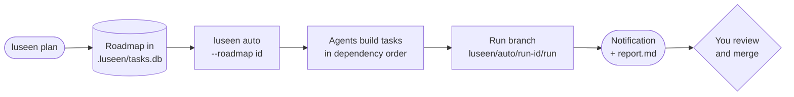
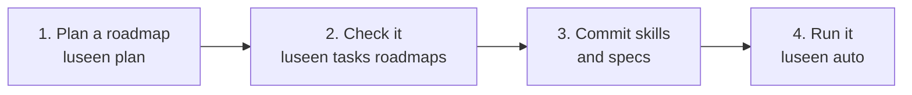
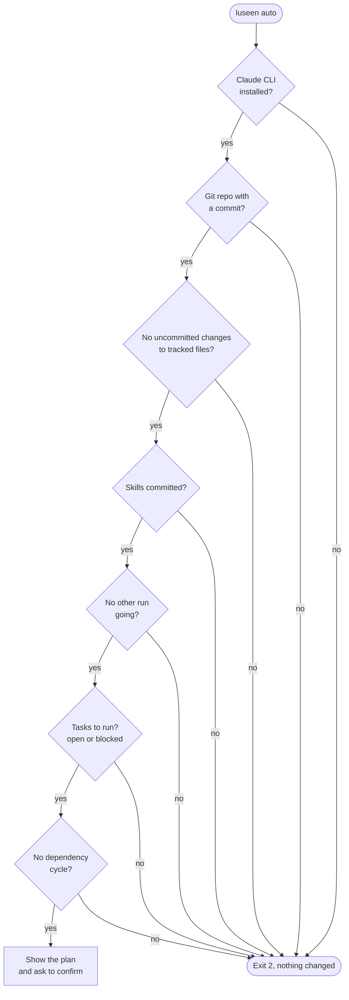
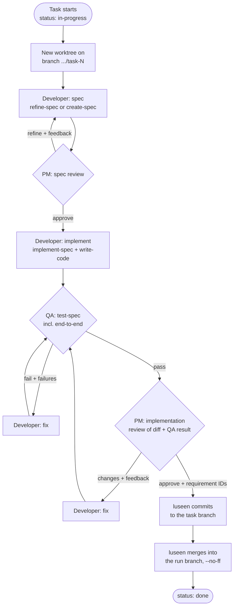
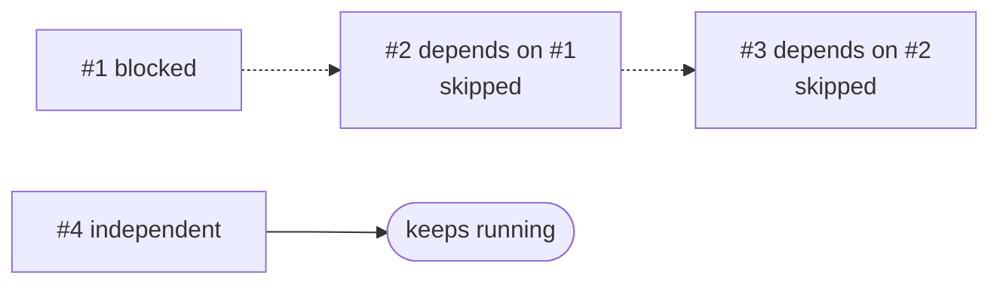
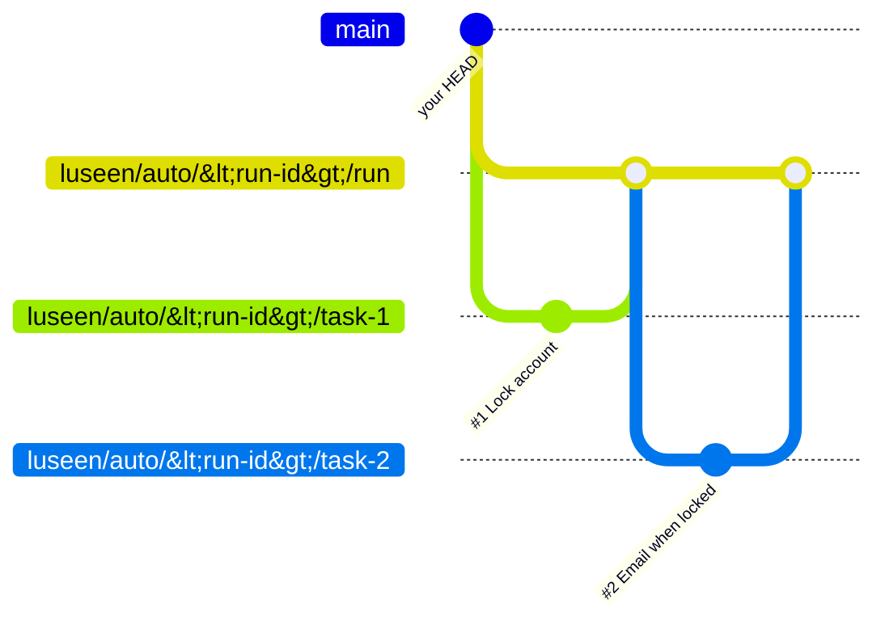
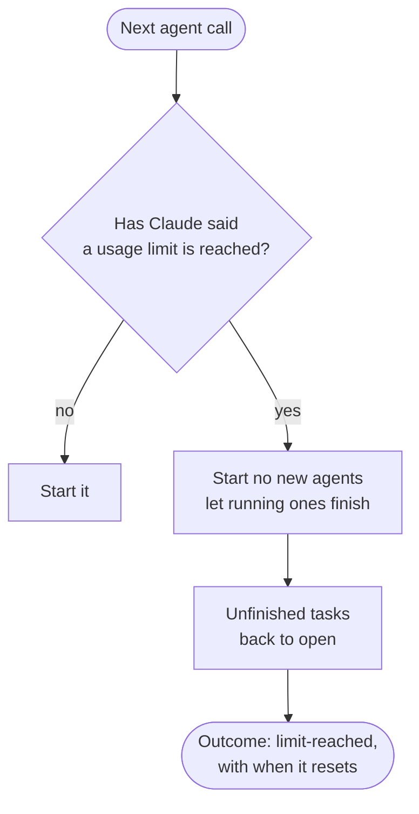
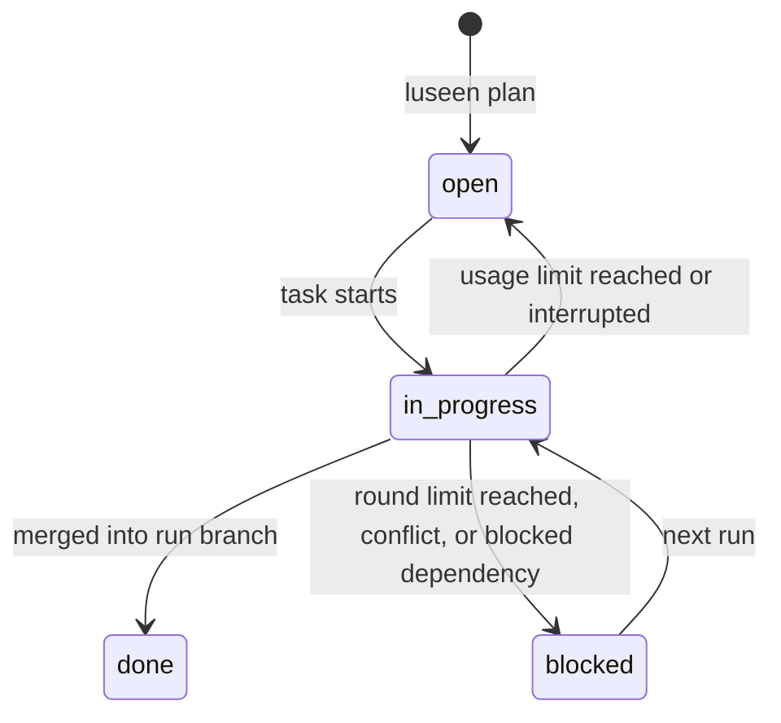
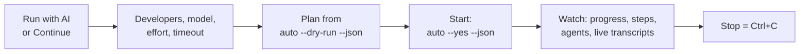

# How automated mode works with `luseen`

How `luseen auto` hands a whole roadmap to a team of Claude CLI agents that build it with no human in the loop, and what you get back when it finishes.

Source of truth: the automated-mode spec in [`.luseen/sdd/specs/automated-mode/`](.luseen/sdd/specs/automated-mode/spec.md), roadmap planning in [`.luseen/sdd/specs/roadmap-planning/`](.luseen/sdd/specs/roadmap-planning/spec.md), and task storage in [`.luseen/sdd/specs/task-tracking/`](.luseen/sdd/specs/task-tracking/spec.md). For how roadmaps are planned, see [PLANNING_FLOW.md](PLANNING_FLOW.md). For the normal, human-approved lifecycle, see [DEVELOPMENT_FLOW.md](DEVELOPMENT_FLOW.md). To start, watch, stop and continue runs from a web page, see [GUI_FLOW.md](GUI_FLOW.md).

---

## 1. The big picture

You plan a roadmap with the PM agent, then hand it to `luseen auto`. Developer, PM and QA agents build each task on their own branches. You get a notification and a report, and you decide whether to merge.



Automated mode only runs a **whole roadmap**. It never pushes, never opens pull requests, and never touches your checked-out branch.

---

## 2. Before you start



1. **Plan a roadmap.** Only the PM agent creates roadmaps: run `luseen plan`, answer its questions, and approve its proposal. `luseen plan --roadmap <id>` adds to an existing one.
2. **Pick it.** `luseen tasks roadmaps` lists them; `luseen tasks roadmap show <id>` shows one with its milestones, tasks and dependencies.
3. **Commit.** Agents work from the last commit, in their own worktrees. Commit the luseen skills (`.agents/skills/`, `.claude/skills/`) and your specs, or the agents won't see them.
4. **Run it:**

```bash
luseen auto --roadmap 1
```

### Options

| Option                     | Meaning                                           | Default        |
| -------------------------- | ------------------------------------------------- | -------------- |
| `--roadmap <id>`           | The roadmap to run. Without it, a menu (TTY only) | menu           |
| `--developers <n>`         | Tasks worked on at the same time, 1 to 8          | 2              |
| `-m, --model` / `--effort` | Model and effort for every agent                  | Claude's own   |
| `--timeout-minutes <n>`    | Time limit for each agent call                    | 30             |
| `-y, --yes`                | Skip the confirmation (needed with no TTY)        |                |
| `--json`                   | Print one JSON result on stdout                   |                |
| `-C, --dir <path>`         | Run on another project                            | current folder |

---

## 3. Checks before anything starts

Each failed check exits 2, says how to fix it, and changes nothing.



- New untracked files are fine, and so are changes to `.luseen/tasks.db`, which luseen updates itself.
- Only one run may work on a project at a time. A lock left by a crashed run is replaced.

### Which tasks run

| Task status   | What happens                                             |
| ------------- | -------------------------------------------------------- |
| `open`        | Runs                                                     |
| `blocked`     | Runs again from the start, on a new branch               |
| `done`        | Left alone; counts as a finished dependency              |
| `in-progress` | Skipped and reported, since someone may be working on it |

A task that depends on a task that's neither `done` nor in this run is reported as blocked before the run starts, along with everything that depends on it.

### The plan you confirm

```text
Roadmap #1: Launch
Run branch: luseen/auto/20261109-080503/run
Developers: 2

Tasks in run order:
  #1 Lock an account after 5 failed logins
  #2 Email the user when locked (after #1)
  #3 Show login history

Won't run:
  #5: Blocked by task #4, which is open

? Start the automated run? (y/N)
```

---

## 4. The team

| Role             | Runs as                                       | Can                                                                                                                     |
| ---------------- | --------------------------------------------- | ----------------------------------------------------------------------------------------------------------------------- |
| **Orchestrator** | luseen itself, no LLM                         | Picks tasks, makes every branch, commit and merge, updates `tasks.db`, enforces limits, writes the report, notifies you |
| **Developer**    | `claude -p` in the task's worktree            | Writes the spec, then the code and tests; fixes what QA or the PM reports                                               |
| **PM**           | A separate `claude -p`, read-only             | Approves or sends back the spec, then the finished work                                                                 |
| **QA**           | A separate `claude -p` in the task's worktree | Tests the change against the spec with `test-spec`, including end-to-end tests                                          |

Every agent runs with `--permission-mode dontAsk`, `--safe-mode` and its own `--session-id`, recorded in `.luseen/auto/<run-id>/sessions/`, so `luseen gui` can show each agent's transcript live. No agent may run `git` or `sudo`, or read `.env` and other secret files. The PM can only read files (Read, Glob, Grep). Only luseen commits.

---

## 5. One task, step by step



- Code is never written before the PM approves the spec.
- The commit message is `#<id> <title>`, followed by the requirement IDs the PM reported.
- A PM or QA reply that isn't a valid verdict, or an agent that fails or times out, counts as a rejected round. An agent stopped by Claude's usage limit doesn't.

### Limits per task

| Stage                    | Max rounds |
| ------------------------ | ---------- |
| PM spec review           | 3          |
| QA run                   | 3          |
| PM implementation review | 3          |

When a limit is reached without approval or a pass, the task becomes `blocked`, with the last feedback or failures as the reason.

---

## 6. Many developers at once

Up to `--developers` tasks run at the same time. A task starts only when every task it depends on is `done`. Ready tasks start in roadmap order: milestone position, then task ID.

```mermaid
gantt
    dateFormat X
    axisFormat %s
    section Developer 1
    #1 Lock account         :t1, 0, 4
    #2 Email when locked (after #1) :t2, 4, 7
    section Developer 2
    #3 Login history        :t3, 0, 5
    #4 Export history (after #3) :t4, 5, 8
```



Each task branches from the run branch's tip **when it starts**, so it already contains the work of the tasks it depends on. Merges into the run branch happen one at a time.

### When a task is blocked



Everything that depends on a blocked task, directly or not, is skipped and reported as blocked by it. Other tasks carry on.

---

## 7. Branches and files



| What          | Where                                                                   |
| ------------- | ----------------------------------------------------------------------- |
| Run branch    | `luseen/auto/<run-id>/run`, from your `HEAD`                            |
| Task branch   | `luseen/auto/<run-id>/task-<id>`, kept after the run                    |
| Task worktree | `.luseen/auto/<run-id>/worktrees/task-<id>`, removed when the task ends |
| Run state     | `.luseen/auto/<run-id>/run.json`, updated after every step              |
| Agent logs    | `.luseen/auto/<run-id>/logs/`                                           |
| Report        | `.luseen/auto/<run-id>/report.md`                                       |

- The run ID is the UTC start time, `YYYYMMDD-HHMMSS`, with a suffix if it's taken.
- Your branch, index and working tree are never changed, apart from `.luseen/tasks.db` and `.luseen/auto/`. `/.luseen/auto/` is added to `.git/info/exclude`, so worktrees don't show in `git status`.
- luseen's own commits and merges use `--no-verify`, so your commit hooks don't reject its messages. They still run when you merge the run branch yourself.
- Secrets are redacted from `run.json` and the logs.

### Merge conflicts

If a task branch conflicts with the run branch, luseen aborts the merge, leaves the run branch as it was, keeps the task branch, and blocks the task with the conflicting files as the reason. Agents never resolve conflicts.

### Unfinished work

A blocked or stopped task keeps its work on its task branch, in a commit marked `(WIP)`. Its worktree is removed. Unapproved work never reaches the run branch.

---

## 8. Claude's usage limits and time

There is no dollar budget. A run uses your Claude plan, and stops cleanly at the plan's usage limit.



- Each agent call saves Claude's newest plan limits (session and weekly use, and when they reset), which `luseen gui` shows in its top bar.
- Each agent call stops after `--timeout-minutes` (default 30).

---

## 9. Ctrl+C or SIGTERM

luseen stops every agent, commits nothing unapproved to the run branch, sets in-progress tasks back to `open`, removes the worktrees, keeps the branches, writes the report with outcome `interrupted`, notifies you, and exits 130 (Ctrl+C) or 143 (SIGTERM).

A run isn't resumed in place. Continue it with a new run (Continue on the roadmap in `luseen gui`, with the same settings): it picks up the tasks that are still `open` or `blocked`.

---

## 10. When it finishes

### Task statuses in `tasks.db`



### Outcome, exit code and notification

| Outcome         | When                                  | Exit code |
| --------------- | ------------------------------------- | --------- |
| `completed`     | Every selected task is `done`         | 0         |
| `partial`       | Some tasks are blocked                | 1         |
| `limit-reached` | Claude's plan usage limit was reached | 1         |
| `interrupted`   | Ctrl+C or SIGTERM                     | 130 / 143 |
| —               | A usage or precondition error         | 2         |

You get a desktop notification for any outcome, such as **"luseen: Launch — Run partial: 2 done, 1 blocked."** It uses `osascript` on macOS, `notify-send` on Linux, and otherwise a terminal bell and a printed message.

With `--json`, stdout is one JSON document with the outcome, the run branch, the report path and each task's result.

### The report

`.luseen/auto/<run-id>/report.md` lists:

- the roadmap, run branch and outcome;
- each task with its result, branch and rounds;
- why each blocked task stopped;
- for `limit-reached`, when Claude's usage limit resets;
- tasks skipped because they were `in-progress`;
- how to review and merge the run branch.

---

## 11. Reviewing and merging

Nothing reaches your branch until you merge it:

```bash
cat .luseen/auto/<run-id>/report.md
git log --oneline luseen/auto/<run-id>/run
git diff HEAD...luseen/auto/<run-id>/run
git merge luseen/auto/<run-id>/run
```

For a blocked task, inspect its branch `luseen/auto/<run-id>/task-<id>`, fix it yourself through the normal [development flow](DEVELOPMENT_FLOW.md), or run `luseen auto` again to retry it.

---

## 12. Runs in the GUI

`luseen gui` does all of this from a roadmap's frame ([GUI_FLOW.md](GUI_FLOW.md)):



- **Run with AI** starts a run on that roadmap, after showing the same plan you'd confirm in the terminal.
- **Continue** replaces it when the newest run was `interrupted` or `limit-reached` and tasks are left. It reuses that run's developers, model, effort and timeout.
- The frame and roadmap panel show the run's progress and each task's status, branch and rounds. The task panel shows each agent's steps and its transcript, live and read-only. Runs started from the terminal show too.
- **Stop** has the same effect as Ctrl+C. Closing the GUI stops a run it started.
- The roadmap panel lists past runs with their `report.md` and agent logs.
- The top bar shows Claude's plan limits, so you can see a limit coming before a run hits it.

---

## 13. Commands you can run yourself

| Command                                           | What it does                                        |
| ------------------------------------------------- | --------------------------------------------------- |
| `luseen plan`                                     | Plan a new roadmap with the PM agent                |
| `luseen plan --roadmap <id>`                      | Add to an existing roadmap                          |
| `luseen plan --task`                              | Plan one task, standalone or in a roadmap           |
| `luseen tasks roadmaps`                           | List roadmaps with their status and task counts     |
| `luseen tasks roadmap show <id>`                  | One roadmap with milestones, tasks and dependencies |
| `luseen tasks depend <id> --on <id>` / `undepend` | Add or remove a dependency                          |
| `luseen auto --roadmap <id>`                      | Run a roadmap with agents                           |
| `luseen auto --roadmap <id> --dry-run`            | Show the plan only, without starting anything       |
| `luseen gui`                                      | Start, watch, stop and continue runs in a web page  |

## 14. Rules to remember

- Only the PM agent creates roadmaps, and auto mode only runs roadmaps.
- No spec is implemented before the PM approves it, and no task is merged before QA passes and the PM approves.
- Only luseen commits and merges, and only on `luseen/auto/<run-id>/` branches. Nothing is pushed.
- Each stage gets at most 3 rounds, then the task is blocked.
- Claude's usage limit stops a run cleanly, and you continue it once the limit resets.
- You decide what gets merged into your branch.
