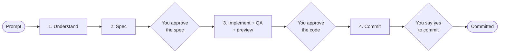
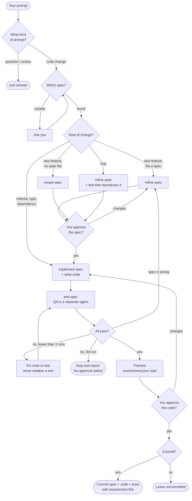
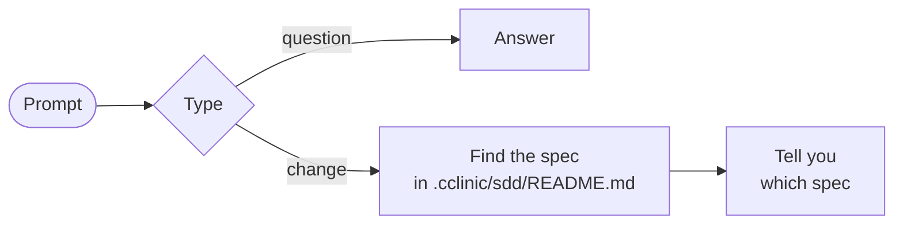
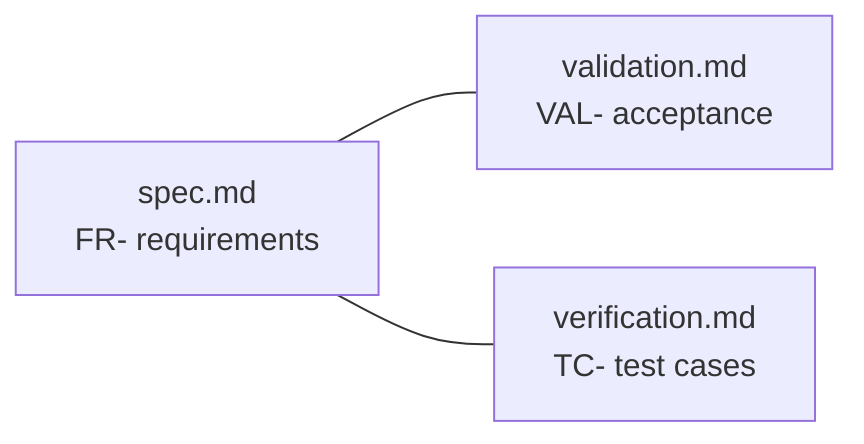
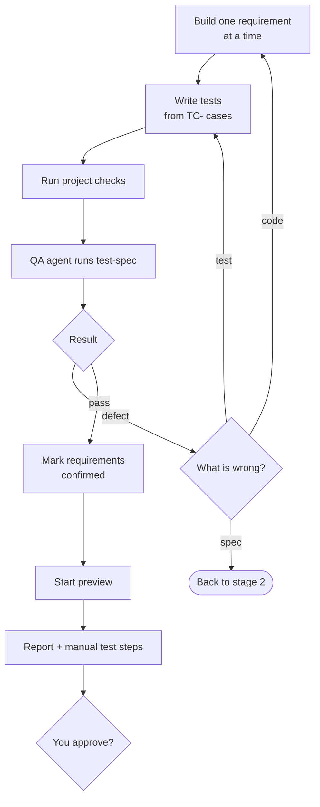
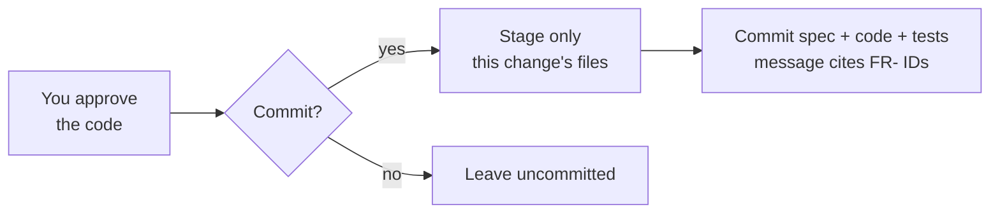

# How development works with `cclinic`

What a coding agent does after `cclinic` setup, from your prompt to a commit.

Source of truth: the workflow in [`AGENTS.md`](AGENTS.md) and the skills in [`.agents/skills/`](.agents/skills/). For the setup itself, see [SETUP_FLOW.md](SETUP_FLOW.md).

---

## 1. The big picture

Every change goes through 4 stages. You approve at each gate. The agent never moves on alone.

---

## 2. The whole flow, step by step

---

## 3. Stage 1: Understand the prompt

If more than one spec fits, or none does, the agent asks you.

---

## 4. Stage 2: Spec first

The agent changes the spec before any code. Each spec has 3 files.

| Change                     | Skill         | What it does                                               |
| -------------------------- | ------------- | ---------------------------------------------------------- |
| New feature, existing area | `refine-spec` | Adds requirements to the spec                              |
| New feature, new area      | `create-spec` | Writes a new spec and adds it to the README                |
| Bug                        | `refine-spec` | Adds a test case that reproduces it, fixes the requirement |
| Refactor, typo, dependency | none          | Skip to stage 3                                            |

Then the agent shows what changed and any open questions, and **stops** until you approve.

---

## 5. Stage 3: Implement, test, preview

- **QA** runs in a separate agent, so the code isn't checked by the agent that wrote it.
- **At most 3 QA runs** per change. After a failed 3rd run, the agent stops and reports.
- **Preview** runs each `start` command in `.cclinic/environment/environment.json`. If it's missing, the `devops` skill sets it up.
- **Report** lists each requirement, the tests and their real results, and steps for any `manual` test case.

---

## 6. Stage 4: Commit

The agent never pushes unless you ask.

---

## 7. Who does what

| Skill            | Used in | Job                                         |
| ---------------- | ------- | ------------------------------------------- |
| `create-spec`    | Stage 2 | Writes a new spec                           |
| `refine-spec`    | Stage 2 | Updates an existing spec                    |
| `implement-spec` | Stage 3 | Builds the spec, requirement by requirement |
| `write-code`     | Stage 3 | Writes all code the project's way           |
| `test-spec`      | Stage 3 | QA: automates and runs test cases           |
| `devops`         | Stage 3 | Sets up and starts the preview              |

## 8. Rules to remember

- No production code before you approve the spec.
- Never weaken a test to make it pass.
- Silence isn't approval. In an unattended run, the agent stops at stage 2.
- You can tell the agent to skip a stage. It says which one it skipped.
