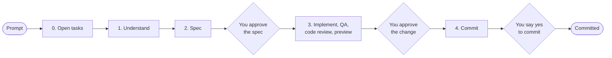
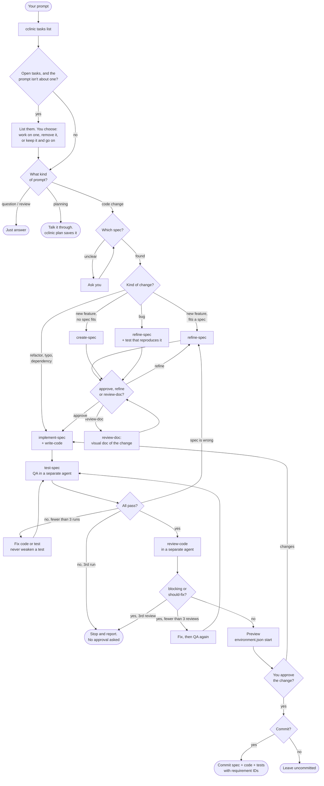
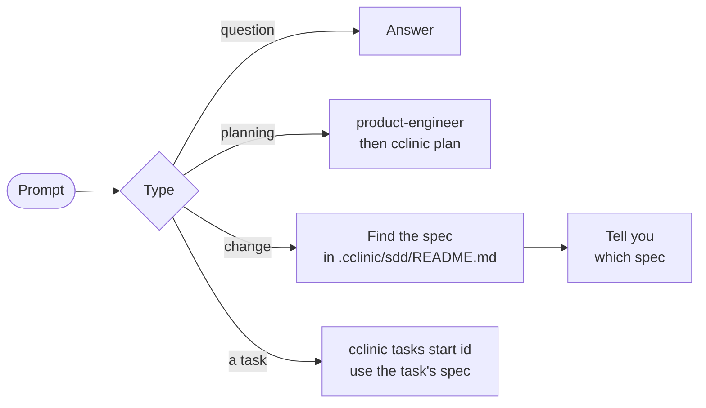
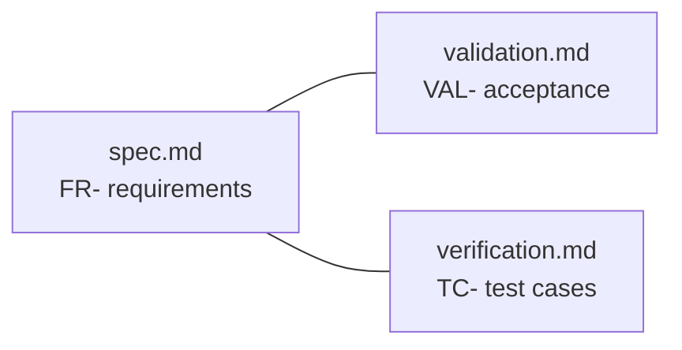
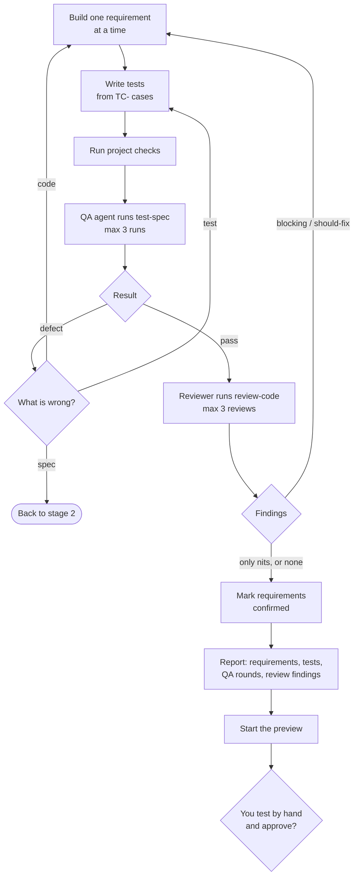
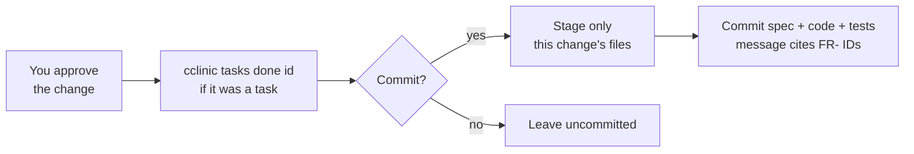

# How development works with `cclinic`

What a coding agent does after `cclinic` setup, from your prompt to a commit.

Source of truth: the workflow in [`AGENTS.md`](AGENTS.md), the skills in [`.agents/skills/`](.agents/skills/), and the [mcp-server](.cclinic/sdd/specs/mcp-server/spec.md) spec. For the setup itself, see [SETUP_FLOW.md](SETUP_FLOW.md). For planning tasks, see [PLANNING_FLOW.md](PLANNING_FLOW.md). For runs with no human, see [AUTO_FLOW.md](AUTO_FLOW.md). For the web page, see [GUI_FLOW.md](GUI_FLOW.md).

---

## 1. The big picture

Every change goes through the same stages. You approve at each gate. The agent never moves on alone.



---

## 2. The whole flow, step by step



---

## 3. Stage 0 and 1: Open tasks, then understand the prompt

On every prompt, the agent first runs `cclinic tasks list --json`. If there are open tasks and your prompt isn't about one of them, it lists them and waits: work on one, remove it, or keep it and go on. It doesn't ask about the same tasks again in that conversation.



If more than one spec fits, or none does, the agent asks you. The agent never creates roadmaps itself. `cclinic plan` does, with the PM agent.

---

## 4. Stage 2: Spec first

The agent changes the spec before any code. Each spec has 3 files.



| Change                     | Skill         | What it does                                               |
| -------------------------- | ------------- | ---------------------------------------------------------- |
| New feature, existing area | `refine-spec` | Adds requirements to the spec                              |
| New feature, new area      | `create-spec` | Writes a new spec and adds it to the README                |
| Bug                        | `refine-spec` | Adds a test case that reproduces it, fixes the requirement |
| Refactor, typo, dependency | none          | Skip to stage 3                                            |

Then the agent shows what changed and any open questions, and **stops** until you choose:

- **`approve`**: go to stage 3.
- **`refine`**: change the spec as you ask, and offer the options again.
- **`review-doc`**: write `.cclinic/reviews/<spec>/review.md`, with diagrams and mockups of how the project will work and look after the change. Then offer `approve` or `refine`. A review doc isn't approval.

---

## 5. Stage 3: Implement, test, review, preview



- **QA** runs in a separate agent, so the code isn't checked by the agent that wrote it. At most 3 QA runs per change.
- **Code review** runs after QA passes, in a separate agent, with `review-code` against your coding rules and `developer-guidelines.md`. Findings are `blocking`, `should-fix` or `nit`. Blocking and should-fix ones are fixed, then QA and the review run again. Nits are only reported. At most 3 reviews.
- The counts start again only after you reply. If a 3rd QA run or review still fails, the agent stops, reports, and doesn't ask for approval.
- **Preview** runs each `start` command in `.cclinic/environment/environment.json`. If it's missing, the `local-env` skill sets it up.
- **Report** lists each requirement, the tests and their real results, the review's findings, and steps for any `manual` test case.

---

## 6. Stage 4: Commit



Review docs in `.cclinic/reviews/` are left out unless you ask. The agent never pushes unless you ask.

---

## 7. The same stages, enforced: `cclinic mcp`

`AGENTS.md` is guidance, so an agent can still skip a step. Connect your coding agent to `cclinic mcp` (Claude Code reads it from `.mcp.json`), and each step becomes a tool call the server checks. A step whose gate hasn't passed is refused.

```
begin → spec ─[G1]→ implement → qa ─[G2]→ review ─[G3]→ preview ─[G4]→ approval ─[G5]→ commit ─[G6]→ done
```

| Gate               | Passes when                                    | Who answers                              |
| ------------------ | ---------------------------------------------- | ---------------------------------------- |
| G1 spec approved   | The spec's 3 files exist and you approve them  | You: `approve`, `refine` or `review-doc` |
| G2 QA passed       | The latest QA run passed, within 3 runs        | The QA agent, with `qa_report`           |
| G3 review approved | The latest review approves, after a passing QA | The reviewer, with `review_report`       |
| G4 preview tried   | `preview_start` ran for this change            | The server                               |
| G5 change approved | You approve the finished change                | You: `approve` or `request changes`      |
| G6 commit agreed   | You agree to commit                            | You: `yes` or `no`                       |

You answer a waiting gate in your agent's own prompt, with `cclinic approve` in a terminal, or with the buttons in the GUI's task panel. The state of each change is kept in `.cclinic/workflow/`.

---

## 8. Watching it in the GUI

`cclinic gui` shows the same work on its canvas ([GUI_FLOW.md](GUI_FLOW.md)):

- A task you work on in your own Claude Code session shows as **Manual**, with its workflow step and your session.
- Each time your session calls a cclinic MCP tool, a Claude Code hook (`cclinic session-link`) records the session on the change, so the GUI can show its transcript, live and read-only.
- A waiting gate shows in **Needs you** and in the task panel, where you can answer it.

---

## 9. Who does what

| Skill              | Used in | Job                                                  |
| ------------------ | ------- | ---------------------------------------------------- |
| `product-engineer` | Stage 1 | Talks through what to build. `cclinic plan` saves it |
| `create-spec`      | Stage 2 | Writes a new spec                                    |
| `refine-spec`      | Stage 2 | Updates an existing spec                             |
| `review-doc`       | Stage 2 | Writes a visual doc of the change, for you to review |
| `implement-spec`   | Stage 3 | Builds the spec, requirement by requirement          |
| `write-code`       | Stage 3 | Writes all code the project's way                    |
| `test-spec`        | Stage 3 | QA: automates and runs test cases                    |
| `review-code`      | Stage 3 | Reviews the change against your coding rules         |
| `local-env`        | Stage 3 | Sets up and starts the preview                       |

## 10. Rules to remember

- No production code before you approve the spec.
- Never weaken a test to make it pass.
- QA and the code review each run at most 3 times. Then the agent stops and reports.
- Silence isn't approval. In an unattended run, the agent stops at stage 2.
- You can tell the agent to skip a stage. It says which one it skipped.
