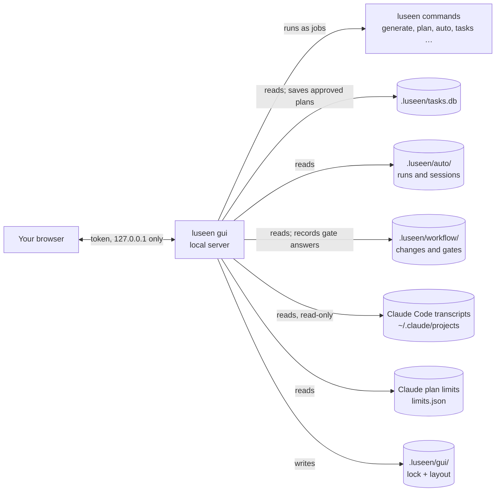
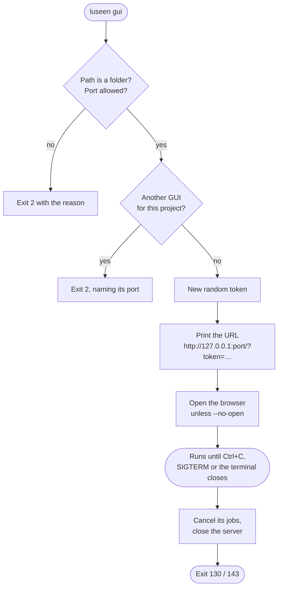
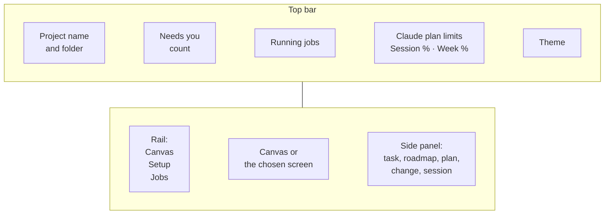
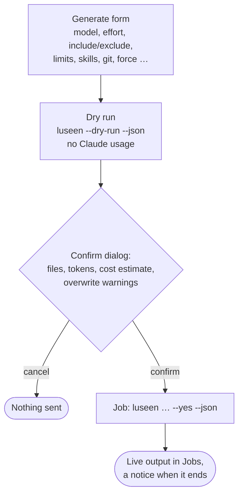
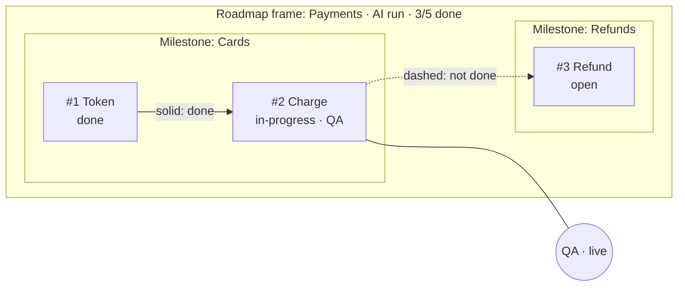
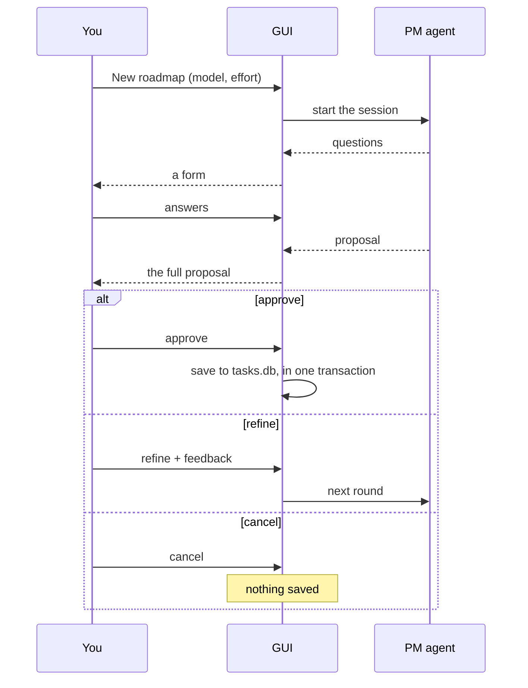
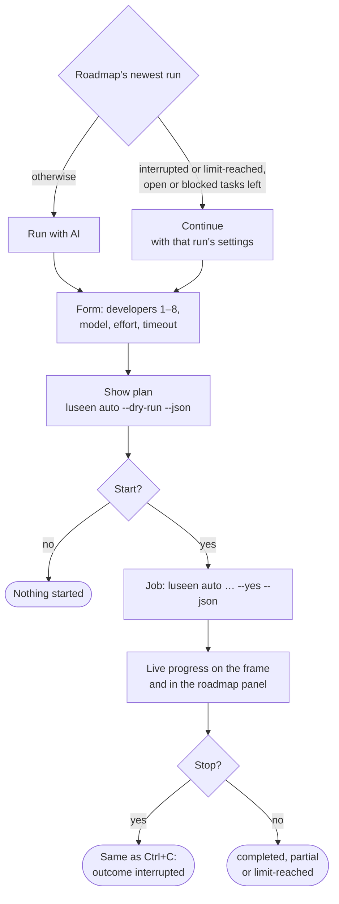
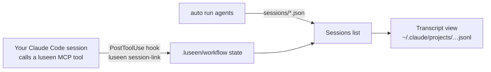

# How the `luseen` GUI works

How `luseen gui` gives each project a local web page, where you can set up luseen, plan with the PM, run roadmaps with AI, answer waiting questions, and watch Claude Code sessions, all without typing commands.

Source of truth: the gui spec in [`.luseen/sdd/specs/gui/`](.luseen/sdd/specs/gui/spec.md), and the code in [`src/cli/gui-command.ts`](src/cli/gui-command.ts) and [`src/gui/`](src/gui/). For setup, see [SETUP_FLOW.md](SETUP_FLOW.md). For planning, see [PLANNING_FLOW.md](PLANNING_FLOW.md). For runs, see [AUTO_FLOW.md](AUTO_FLOW.md). For the human-approved lifecycle, see [DEVELOPMENT_FLOW.md](DEVELOPMENT_FLOW.md).

---

## 1. The big picture

The GUI isn't an AI client. It never chats with Claude itself. It runs luseen's own commands, reads the files they write, and shows them. Two things it does itself, with luseen's own code: it records your answer to a waiting gate in `.luseen/workflow/`, as `luseen approve` does, and it saves a plan you approve to `tasks.db`, as `luseen plan` does. The same action from the GUI and from the terminal has the same effect.



---

## 2. Starting and stopping

```bash
luseen gui                 # this project, opens your browser
luseen gui ./my-project    # another project
luseen gui --no-open --port 0 --json
```

| Option                | Meaning                         | Default                              |
| --------------------- | ------------------------------- | ------------------------------------ |
| `[path]`, `-C, --dir` | The project                     | current folder                       |
| `--port <n>`          | Port to use, 0 picks a free one | 4417, or a free port when it's taken |
| `--no-open`           | Don't open the browser          | opens it                             |
| `--json`              | Print `{"url", "port"}` only    |                                      |



- The URL holds a new token each time. It's never written to disk or a log. Keep it to yourself.
- Only one GUI runs per project. A lock left by a GUI that crashed is replaced.
- An auto run started from the GUI is a job, so closing the GUI stops it, as Ctrl+C would.

---

## 3. The screen



| Place         | Shows                                                                                    |
| ------------- | ---------------------------------------------------------------------------------------- |
| **Canvas**    | Every roadmap, its tasks, their dependencies, agents and sessions. The default screen.   |
| **Setup**     | `doctor`, generate, skills, environment, model, clean, and how to connect `luseen mcp`.  |
| **Jobs**      | Every command the GUI ran, with its live output and exit code.                           |
| Side panels   | A task, a roadmap, a plan, a change or a session, opened over the canvas. Escape closes. |
| **Needs you** | Every PM question or proposal, waiting gate, and job confirmation. Each opens its panel. |

Every screen and panel has its own URL, so reload, back and forward keep your place. There's a light and a dark theme, and everything works by keyboard.

---

## 4. Setup

When the project has no `.luseen/sdd`, the GUI opens on Setup and says generating is the first step.



- The dialog asks what the terminal would ask, and the job starts only after you answer.
- Setup also runs `skills`, `environment`, `model --list`, choosing a model, `model --reset` and `clean`, with the same confirmations.
- It shows the `.mcp.json` entry for `luseen mcp` and whether it's installed. Your coding agent starts the MCP server, not the GUI.

---

## 5. The canvas



- **Frames** are roadmaps, with their title, goal, status, mode and done count. **Columns** are milestones, in order. **Cards** are tasks.
- Tasks with no milestone sit in an **Unassigned tasks** frame. Changes in `.luseen/workflow/` that have no task get a **Changes without a task** frame.
- **Add a task** creates a task, and a roadmap or milestone can be removed after a confirmation. New roadmaps and milestones come only from Plan.
- A card shows its ID, title, first lines, status, spec, workflow step, mode, the agents on it now, and its sessions.
- **Arrows** go from a task to the tasks that depend on it: solid when done, dashed when not.
- **Mode**: **AI run** while an auto run holds it, **Manual** while you work on it in your own Claude Code session.
- **Show sessions** draws each task's Claude Code sessions as small nodes beside its card.
- Pan, zoom (25 % to 200 %), Fit, and drag cards and frames. Positions are saved in `.luseen/gui/layout.json`, never in `tasks.db`.
- Search, filter by status, mode or spec, Hide done, or jump to a roadmap. The **List** view shows the same data as text.
- A banner suggests the next step: Generate, Plan a roadmap, Run with AI, or open the running roadmap.
- Changes from the terminal, an agent or a run show up within 2 seconds, with no reload.

---

## 6. Plan with the PM

**New roadmap** on the canvas, **Plan a task** on a roadmap frame (`luseen plan --task --roadmap <id>`), or planning more into a roadmap from its panel (`luseen plan --roadmap <id>`) starts the same session as `luseen plan`.



- Only an approved plan is saved. Cancelling, closing the GUI or a failed PM call saves nothing.
- One planning session runs at a time. Reopen the browser and you're back at the current question.
- If Claude's usage limit is reached, the PM stops, nothing is saved, and the GUI says when it resets.

---

## 7. Run a roadmap with AI



- The GUI refuses a run when the CLI would, with the CLI's reason: another run going, tracked changes, no commit, or the Claude CLI or skills missing.
- While a run is going, the roadmap panel shows its outcome so far and each task's status, branch and rounds, from `run.json`. Runs started from the terminal show too.
- Stop works for runs the GUI started. For a run started elsewhere, the GUI says which process to stop.
- The roadmap panel lists past runs, with each `report.md` and the agent logs.
- **Continue** appears when the newest run was stopped or hit Claude's usage limit and tasks are left. It shows the plan with that run's developers, model, effort and timeout, then starts a new run.

There's no dollar budget. A run stops cleanly at Claude's usage limit, and you continue it once the limit resets.

---

## 8. The task panel

Click a card to open its panel:

| Section          | Shows or does                                                                                                                                                                                                                          |
| ---------------- | -------------------------------------------------------------------------------------------------------------------------------------------------------------------------------------------------------------------------------------- |
| Details          | ID, title, description, status, spec, dependencies, and the run that holds it                                                                                                                                                          |
| Actions          | The `luseen tasks` changes for one task: start, done, depend, undepend, remove. Removing asks first.                                                                                                                                   |
| Workflow steps   | In an AI run: spec, spec review, implement, QA, PM review, merge. In your own session: spec, implement, QA, code review, preview, approval, commit. Each is not started, running, passed, sent back or failed, with its round and time |
| Agents           | Who works on it now: Developer, PM or QA in a run, or You in your own session                                                                                                                                                          |
| Waiting question | A gate, skip or resume question from the MCP server, with one button per answer, like `luseen approve`                                                                                                                                 |
| Sessions         | Its Claude Code sessions, newest first, live or ended                                                                                                                                                                                  |
| Transcript       | The open session's messages, tool calls and results, live and **read-only**                                                                                                                                                            |



- Transcript lines it can't read are skipped and counted. A missing transcript says "transcript not found".
- Views follow new lines while scrolled to the bottom. Scroll up and a "Jump to latest" button appears.
- Search the text, filter by user, assistant, tool call or tool result, and unfold long tool results.
- The GUI can't send input to, resume or stop a Claude Code session.

---

## 9. Claude plan limits

The top bar mirrors your Claude plan's usage, not dollars.

```
Session 42 % · resets 3:00 PM    Week 83 % · resets Sun 9:00 AM    as of 3 min ago
```

- Each agent call luseen makes saves Claude's newest limits to `limits.json`, next to luseen's saved model.
- A window at 80 % or more is marked. A reached limit reads "Limit reached · resets <time>".
- Once a reset time has passed, that window reads "Session · reset at <time>" until the next agent call reads new limits.
- Before the first agent call, nothing is shown. The limits never show a dollar amount, and neither do runs, tasks or sessions.

---

## 10. Jobs

Every action that runs a command is a job: `luseen <command> … --json`, a child process started with an argument array, never through a shell.

- Output streams to the browser as it's written. A page opened later gets the output so far first.
- Conflicting jobs don't run together: one generate or clean, one environment, one auto run, and none of generate, clean, skills or environment while another of them runs. The refusal names the job that blocks it.
- A notice shows each result. A success notice closes by itself, and a failure stays until you close it.
- Jobs and their output last only as long as the GUI. Nothing is written to disk except what the commands write.

---

## 11. Safety

| Rule                   | How                                                                                                                                                                                                                          |
| ---------------------- | ---------------------------------------------------------------------------------------------------------------------------------------------------------------------------------------------------------------------------- |
| This machine only      | Listens on `127.0.0.1`. Checks the `Host` header and, for changes, the `Origin`.                                                                                                                                             |
| Token on every request | From the URL on the first load, then a `SameSite=Strict`, `HttpOnly` cookie.                                                                                                                                                 |
| No outside code        | Its own files only, with a strict `Content-Security-Policy`. No new dependency.                                                                                                                                              |
| No secrets             | Never reads `.env` or other secret files. Every text it sends is redacted.                                                                                                                                                   |
| Allow-listed paths     | Every ID and path in a request must match a pattern or an existing record, or 404.                                                                                                                                           |
| Read-only sessions     | Transcripts are shown, never written to or driven.                                                                                                                                                                           |
| Few writes             | Its own files are only in `.luseen/gui/` (lock and layout), which Git ignores and `luseen clean` keeps. Besides those, it writes only gate answers to `.luseen/workflow/` and approved plans to `tasks.db`, as the CLI does. |

---

## 12. Rules to remember

- The GUI runs luseen's own commands. It adds no rules and never talks to Claude itself.
- Roadmaps are created only by Plan, as in the CLI.
- Nothing costly or destructive starts without a confirmation that names it.
- Moving cards never changes your tasks.
- Close the GUI and any run it started stops, like Ctrl+C. Continue it later from its roadmap.
