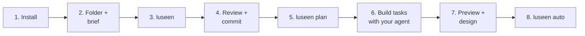

# New project with `luseen`: step by step

Every command you run to start a new project with luseen, in order, with what to type and what to answer. Copy them one step at a time.

For a codebase that already works, see [SETUP_FLOW.md, Path B](SETUP_FLOW.md#4-path-b-an-existing-project). More detail: [PLANNING_FLOW.md](PLANNING_FLOW.md), [DEVELOPMENT_FLOW.md](DEVELOPMENT_FLOW.md), [AUTO_FLOW.md](AUTO_FLOW.md), [GUI_FLOW.md](GUI_FLOW.md).



> **Order matters.** `luseen plan` needs `.luseen/sdd/`, and `luseen` needs at least one file to read. So: brief first, then `luseen`, then `luseen plan`.

---

## Step 1: Install (once per computer)

```bash
node --version                  # must be v22.18.0 or newer
npm install -g luseen
claude auth login               # Claude Code login: needed for plan, environment, design and auto
luseen doctor                   # checks Node.js, Claude, Git. Fix anything it flags
```

Optional, pick the default model once:

```bash
luseen model --model sonnet --effort medium
```

---

## Step 2: Create the folder and write a brief

```bash
mkdir clinic-booking && cd clinic-booking
git init
```

Create `README.md` with what you want to build. Copy this template and fill it in:

```markdown
# <Project name>

## What it is

<One or two sentences.>

## Who uses it

- <Role>: <what they do>
- <Role>: <what they do>

## Main features

### <Feature area 1>

- <Rule, with numbers: "Cancel up to 2 hours before">
- <Rule>

### <Feature area 2>

- <Rule>

## Stack

<Languages, frameworks, database, test tools. Or "undecided, recommend one".>

## How we write code

- <Lint, formatting, tests, commit style>

## Out of scope for now

<What not to build.>
```

Each `###` feature area usually becomes one spec. Rules with numbers become testable requirements.

**Know your stack?** Run the scaffolder now, so luseen reads your real tools:

```bash
npm create vite@latest . -- --template react-ts    # or rails new ., etc.
git add -A && git commit -m "chore: scaffold"
```

Don't build features yet. They come through specs and tasks.

---

## Step 3: Generate the specs

```bash
luseen --dry-run                # see what will be read and the estimated cost. Sends nothing
luseen                          # generates the specs. Asks before sending anything
```

What luseen asks, and what to answer:

| Question                                | Answer                                                    |
| --------------------------------------- | --------------------------------------------------------- |
| Send these files to Claude?             | **yes**                                                   |
| Set up the local environment (preview)? | **no**, if nothing runs yet. You'll do it in step 7       |
| Create the design system?               | **yes** if you want it now, or **no** and do it in step 7 |

What you get:

```text
.luseen/sdd/README.md            ← list of specs
.luseen/sdd/overview.md          ← what the project is
.luseen/sdd/open-questions.md    ← what luseen couldn't tell from the brief
.luseen/sdd/developer-guidelines.md  ← rules every agent follows
.luseen/sdd/specs/<area>/        ← spec.md, validation.md, verification.md
AGENTS.md, CLAUDE.md, .agents/, .claude/, .mcp.json   ← agent setup
```

Stopped halfway (usage limit)? Run `luseen` again. It continues where it stopped.

---

## Step 4: Review and commit

1. Open `.luseen/sdd/open-questions.md` and write your answers in it.
2. Open Claude Code (or your agent) in the folder and say:

   ```text
   refine the specs using my answers in open-questions.md
   ```

   Reply `approve` when it shows the changes.

3. Add a `.gitignore` (luseen never creates one):

   ```bash
   printf '.luseen/cache/\n.luseen/failed/\n.luseen/.lock\n' >> .gitignore
   ```

4. Commit:

   ```bash
   git add .gitignore README.md .luseen/sdd .agents .claude AGENTS.md CLAUDE.md .mcp.json
   git commit -m "chore: set up luseen specs and agent skills"
   ```

---

## Step 5: Plan the roadmap

```bash
luseen plan
```

Choose **New roadmap**, then type what you want. A good first message:

```text
Plan the first release from the specs. Start with a Foundation milestone:
scaffold (if there's no code yet), lint, tests, a runnable app shell.
Then one milestone per feature area, smallest first. Keep tasks small.
```

Attach files (they must be inside the project folder):

```bash
luseen plan --attach docs/requirements.pdf --attach docs/mockup.png
```

The PM asks a few questions, then proposes milestones and tasks. Reply in your own words to change it, or **approve** to save it.

```bash
luseen tasks roadmap            # see every roadmap with its tasks
luseen tasks list               # what's open, in roadmap order
```

Other planning commands:

| Command                          | Does                                 |
| -------------------------------- | ------------------------------------ |
| `luseen plan --task`             | Plan one task                        |
| `luseen plan --roadmap 1`        | Add more milestones to roadmap 1     |
| `luseen plan --task --roadmap 1` | Add one task to roadmap 1            |
| `luseen plan --resume`           | Continue a planning session you left |

Prefer a browser? `luseen gui`, then **New roadmap** on the canvas.

---

## Step 6: Build the first tasks with your agent

Open Claude Code (or Codex, Cursor, Copilot, Gemini CLI) in the project and say:

```text
work on task 1
```

The agent stops and waits for you at each gate. What to reply:

| The agent shows                      | You reply                                                                       |
| ------------------------------------ | ------------------------------------------------------------------------------- |
| The spec change                      | `approve`, `refine <what to change>`, or `review-doc` to see a visual doc first |
| The result, a preview and test steps | Try it, then `approve` or describe what to change                               |
| "Commit it?"                         | `yes` or `no`                                                                   |

Between those gates it writes the code and tests, runs QA (up to 3 times) and a code review (up to 3 times) on its own.

Then `work on task 2`, and so on through the Foundation milestone. Build this milestone yourself, not with `luseen auto`: it sets the conventions every later task copies.

Other things you can just say to your agent:

| You say                                                         | What happens                                 |
| --------------------------------------------------------------- | -------------------------------------------- |
| "Add a reminder email 24 hours before"                          | New requirement in the spec, then the build  |
| "Booking the same slot twice shows no error"                    | Bug: a test that reproduces it, then the fix |
| "What does the booking spec cover?"                             | Just an answer                               |
| "Refine stack.md and developer-guidelines.md to match the code" | Specs updated after the foundation           |

Agent waiting on a question and you'd rather answer in a terminal? Run `luseen approve`.

---

## Step 7: Preview and design system

Once the app starts locally (after the scaffold task):

```bash
luseen environment              # saves how to run the app, so every change ends with a preview
```

For a project with screens, before the first real screen:

```bash
luseen design                   # writes the design system to .luseen/design/
```

If you skip `luseen design`, your agent creates the design system at the first change that touches UI, and asks you to approve it.

Commit both:

```bash
git add .luseen/environment .luseen/design
git commit -m "chore: add local preview and design system"
```

---

## Step 8: Let agents build a milestone

Once the foundation is in, agents can build whole milestones on their own branches:

```bash
git status                              # must be clean: commit first
luseen auto --roadmap 1 --dry-run       # checks everything, shows the plan. Starts nothing
luseen auto --roadmap 1                 # runs it
luseen auto --roadmap 1 --developers 3  # more agents at once (1 to 8, default 2)
```

Your branch is never touched and nothing is pushed. When it finishes:

```bash
cat .luseen/auto/<run-id>/report.md     # what was built, what was blocked
git log luseen/auto/<run-id>/run        # the work
git merge luseen/auto/<run-id>/run      # merge it when you're happy
```

Usage limit reached? The run stops cleanly. Continue it later from `luseen gui`.

---

## Every day

```bash
luseen gui                      # roadmap canvas, running agents, questions waiting for you
luseen tasks list               # open tasks
luseen tasks show 5             # one task in full
luseen plan --task              # a new idea, as one task
```

Then in your agent: `work on task 5`.

Track tasks by hand when you need to:

```bash
luseen tasks start 5
luseen tasks done 5
luseen tasks add --title "Fix slot timezone" --spec booking --description "src/slots.ts:42 uses local time"
luseen tasks depend 6 --on 5
luseen tasks remove 7
```

After upgrading luseen:

```bash
npm install -g luseen@latest
luseen skills                   # updates the skills and AGENTS.md section. No Claude usage
```

---

## Rules that save you trouble

- **Change behaviour through your agent, not by hand.** It updates the spec first, then the code and tests.
- **After setup, the specs are the source of truth, not the README.** To change a requirement, ask the agent to refine the spec.
- **Don't run `luseen --force` on a project you've been working on.** It replaces the specs you and your agents refined.
- **Keep tasks small:** one rule or screen per task.
- **Commit after every approved task.**
- **Build the foundation by hand, then use `luseen auto`.**
- **Check `luseen tasks list` now and then.** Agents save problems they notice as tasks there.

## When something goes wrong

| You see                                        | Do                                                           |
| ---------------------------------------------- | ------------------------------------------------------------ |
| `luseen plan`: `.luseen/sdd` doesn't exist     | Run `luseen` first (step 3)                                  |
| `luseen`: "No files to analyse remain…"        | Write `README.md` first (step 2)                             |
| `luseen plan` exits 2 about Claude or `claude` | `claude auth login`                                          |
| Exit 4, usage limit                            | Wait for the reset, run the same command again               |
| `luseen auto` refuses to start                 | Commit everything, then `luseen auto --dry-run` to see why   |
| The agent skips the steps                      | `luseen skills`, and check `CLAUDE.md` contains `@AGENTS.md` |
| `luseen: command not found`                    | Use `npx luseen`, or add npm's global bin to `PATH`          |
| Anything else                                  | `luseen doctor`, or `luseen guide`                           |
