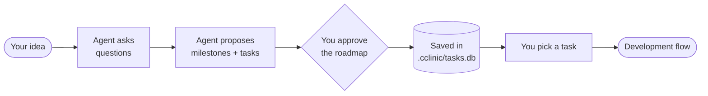
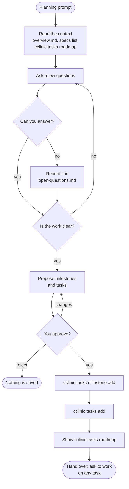
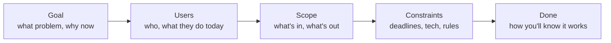
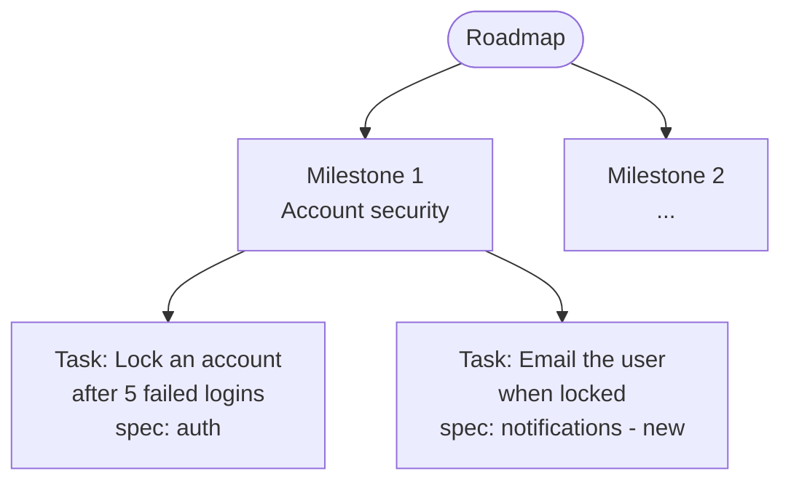
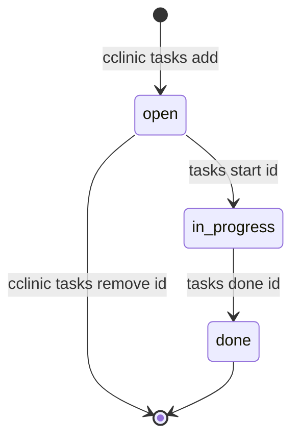
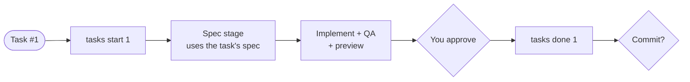

# How planning works with `cclinic`

How to use the `product-engineer` skill to turn an idea into a roadmap of tasks, and how those tasks then flow into development.

Source of truth: the skill in [`.agents/skills/product-engineer/`](.agents/skills/product-engineer/SKILL.md), the workflow in [`AGENTS.md`](AGENTS.md), and the task-tracking spec in [`.cclinic/sdd/specs/task-tracking/`](.cclinic/sdd/specs/task-tracking/spec.md). For what happens when you work on a task, see [DEVELOPMENT_FLOW.md](DEVELOPMENT_FLOW.md). To plan from a web page (New roadmap, or Plan a task on a roadmap), see [GUI_FLOW.md](GUI_FLOW.md).

---

## 1. The big picture

You describe what you want. The agent asks questions, proposes a roadmap, and saves it only after you approve. Each task is later built through the normal development flow.



The planning agent never writes code, tests or specs. It only plans.

---

## 2. How to start

Just ask your coding agent in plain words. For example:

| You say                                          | What happens                      |
| ------------------------------------------------ | --------------------------------- |
| "Help me plan what to build next."               | Starts planning from scratch      |
| "I want users to reset their password. Plan it." | Plans one feature as tasks        |
| "Build a roadmap for the first release."         | Proposes milestones for a release |
| "Split task #3 into smaller tasks."              | Refines an existing task          |
| "Use product-engineer to plan billing."          | Asks for the skill by name        |

Any prompt about planning, roadmaps, creating or refining tasks, or deciding what to build goes to `product-engineer`. No spec or code work starts.

---

## 3. The whole flow, step by step



---

## 4. Step 1: Questions first

Before proposing anything, the agent reads what the project already knows, then asks a few focused questions at a time.



- It skips anything the documents already answer.
- It never guesses. If you can't answer, it adds the question to `.cclinic/sdd/open-questions.md` and tells you.

---

## 5. Step 2: The proposal

The agent groups the work into milestones, in build order. Each milestone has a goal. Each task is **one deliverable change** and names its spec.



What you see before approving:

```markdown
**Milestone 1: Account security.** Goal: stop password guessing

| Task                                        | Spec                     | Notes                   |
| ------------------------------------------- | ------------------------ | ----------------------- |
| Lock an account after 5 failed logins       | auth                     |                         |
| Email the user when their account is locked | notifications (new spec) | Needs an email provider |
```

A task either names an existing spec, or says a new spec is needed with a suggested name.

You can approve it, ask for changes (the agent revises and asks again), or reject it (nothing is saved).

---

## 6. Step 3: Saving

Only after you approve, the agent saves each milestone, then its tasks:

```bash
cclinic tasks milestone add --title "Account security" --goal "Stop password guessing" --json
cclinic tasks add --title "Lock an account after 5 failed logins" --milestone 1 --spec auth --json
```

Then it shows the result:

```text
$ cclinic tasks roadmap
Milestone #1: Account security
  Goal: Stop password guessing
  #1 [open] Lock an account after 5 failed logins (spec: auth)
  #2 [open] Email the user when locked (spec: notifications)
```

Tasks live in `.cclinic/tasks.db`, a local SQLite file. The commands need no Claude usage and no network. The agent never edits the database directly.

---

## 7. From task to code

When you ask to work on a task, it goes through the normal development flow, and its status follows along.





See [DEVELOPMENT_FLOW.md](DEVELOPMENT_FLOW.md) for each stage.

---

## 8. Open tasks on every prompt

On every prompt, the agent first runs `cclinic tasks list --json`. If tasks are open and your prompt isn't about one of them, it lists them and waits for you to choose.


Once you choose **keep**, the agent doesn't ask about the same tasks again in that conversation. It asks again only when a new task appears.

---

## 9. Commands you can run yourself

| Command                                                          | What it does                            |
| ---------------------------------------------------------------- | --------------------------------------- |
| `cclinic tasks roadmap`                                          | Milestones in order, with their tasks   |
| `cclinic tasks list`                                             | Open and in-progress tasks, in order    |
| `cclinic tasks show <id>`                                        | Every detail of one task                |
| `cclinic tasks add --title "..." --milestone <id> --spec <name>` | Add a task                              |
| `cclinic tasks start <id>` / `done <id>`                         | Change a task's status                  |
| `cclinic tasks remove <id>`                                      | Delete a task permanently               |
| `cclinic tasks milestone add --title "..." --goal "..."`         | Add a milestone after the existing ones |
| `cclinic tasks milestone remove <id>`                            | Remove a milestone; its tasks are kept  |

Add `--json` for machine-readable output, or `-C <folder>` to work on another project.

## 10. Rules to remember

- Planning never changes code, tests or specs.
- Nothing is saved until you approve the roadmap.
- Unanswered questions become open questions, never guesses.
- Each task is one deliverable change, tied to one spec.
- Work on a task always goes through the spec stage first.
