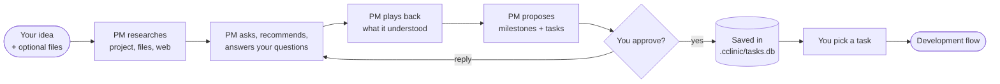
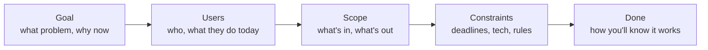
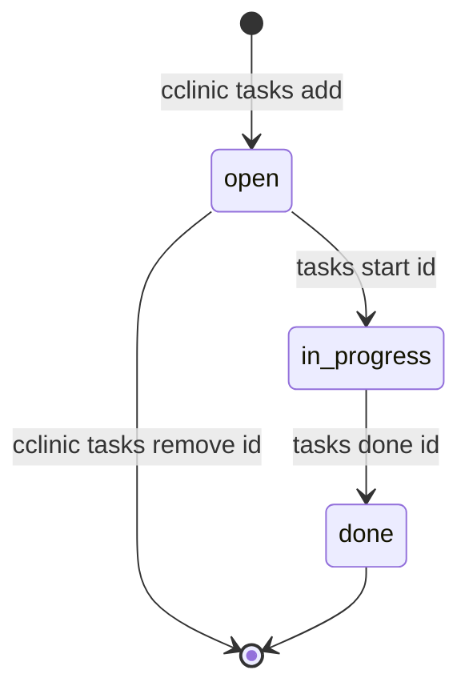
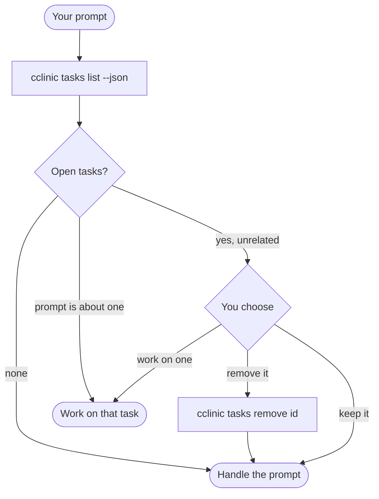

# How planning works with `cclinic`

How to plan with the PM agent, in a terminal, in the GUI or in Claude Code, to turn an idea into a roadmap of tasks, and how those tasks then flow into development.

Source of truth: the roadmap-planning spec in [`.cclinic/sdd/specs/roadmap-planning/`](.cclinic/sdd/specs/roadmap-planning/spec.md), the skill in [`.agents/skills/product-engineer/`](.agents/skills/product-engineer/SKILL.md), and the task-tracking spec in [`.cclinic/sdd/specs/task-tracking/`](.cclinic/sdd/specs/task-tracking/spec.md). For what happens when you work on a task, see [DEVELOPMENT_FLOW.md](DEVELOPMENT_FLOW.md). To plan from a web page (New roadmap, or Plan a task on a roadmap), see [GUI_FLOW.md](GUI_FLOW.md).

---

## 1. The big picture

Planning is a conversation with a PM agent: one real Claude Code session that follows the `product-engineer` skill. You describe what you want, in your own words, and can attach screenshots, mockups or documents. The PM researches your project, your files and, when it helps, the web. It asks a few questions at a time, recommends options, plays back what it understood, and then proposes a roadmap or one task. cclinic saves it only after you approve.



The PM never writes code, tests or specs, and never saves anything itself. It proposes through cclinic's `plan_propose` tool, and cclinic checks the plan and saves it after you approve.

---

## 2. Three places to plan, one conversation

| Where       | How to start                                           | Notes                                                    |
| ----------- | ------------------------------------------------------ | -------------------------------------------------------- |
| Terminal    | `cclinic plan`, or `cclinic plan --task` for one task  | `--attach brief.pdf` adds files to your first message    |
| GUI         | New roadmap on the canvas, or Plan a task on a roadmap | The Plan panel is a chat; drop or paste files            |
| Claude Code | Ask "plan a roadmap for …"                             | The skill calls `plan_begin` on the `cclinic` MCP server |

A planning session is saved as it goes. Continue it anywhere with the commands cclinic shows you:

```bash
cclinic plan --resume plan-3        # in a terminal (or --resume alone to pick from a list)
claude --resume <claude-session-id> # in Claude Code
```

The GUI lists every open session and mirrors the conversation live, whoever is driving it. Only one place drives a session at a time.

---

## 3. In the terminal

```text
You › A patient portal for clinics, see @docs/brief.pdf
  · Read brief.pdf
  · Searched the web: patient portal GDPR
PM › From the brief: … Which country are the clinics in? It decides HIPAA or GDPR.

  1. USA (HIPAA)
  2. EU (GDPR)
```

| You type             | What it does                                                        |
| -------------------- | ------------------------------------------------------------------- |
| Any text             | Your reply. `@path` or `@"path with spaces"` attaches a file        |
| `/attach <path>`     | Attach a file with no text                                          |
| A number             | Send that suggested answer                                          |
| `/propose`           | Ask the PM to propose now, listing what's unclear as open questions |
| `/approve`           | Save the waiting proposal                                           |
| `/cancel`            | End the session; nothing is saved                                   |
| A line ending in `\` | Continue your message on the next line                              |

Attachments: images (`.png`, `.jpg`, `.jpeg`, `.gif`, `.webp`, up to 5 MB) and documents (`.pdf`, `.docx`, `.md`, `.txt`, `.csv`, up to 20 MB), at most 10 per message and 30 per session. cclinic copies them into `.cclinic/plans/<id>/`, which git ignores.

Ctrl+C keeps the session and prints how to continue it. A run stops at your Claude plan's usage limit or after 40 PM turns, also keeping the session.

---

## 4. In Claude Code

Ask your agent to plan. The `product-engineer` skill calls `plan_begin`, talks it through with you, and calls `plan_propose`. cclinic then asks you **approve**, **keep chatting** or **cancel**. If your agent can't show that question, approve it in the GUI's Needs you, or with `cclinic approve` in your own terminal.

Without the `cclinic` MCP server in `.mcp.json`, the skill can still talk it through, but tells you to run `cclinic plan` to save it.

---

## 5. What the PM asks about



- At most 3 questions per message, the most important first, each with why it matters.
- It skips anything your project, specs or files already answer.
- It never guesses. What you can't answer becomes an open question in the proposal.

---

## 6. The proposal and saving

The PM groups the work into milestones, in build order. Each task is **one deliverable change**, names its spec (or says a new spec is needed), and lists the tasks it depends on. cclinic checks the plan first; a broken one goes back to the PM before you see it.

```text
Roadmap: Patient portal
Goal: Patients book visits and see results online

Milestone 1: Sign-in
  Goal: Patients can log in safely
  [login] Magic-link login - spec: new spec

Open questions:
  - Add passkeys later?
```

On approve, cclinic saves the roadmap, milestones and tasks in one step, and tells you how to run it with `cclinic auto --roadmap <id>`. Tasks live in `.cclinic/tasks.db`, a local SQLite file.

---

## 7. From task to code

When you ask to work on a task, it goes through the normal development flow, and its status follows along.




See [DEVELOPMENT_FLOW.md](DEVELOPMENT_FLOW.md) for each stage.

---

## 8. Open tasks on every prompt

On every prompt, the agent first runs `cclinic tasks list --json`. If tasks are open and your prompt isn't about one of them, it lists them and waits for you to choose.



Once you choose **keep**, the agent doesn't ask about the same tasks again in that conversation. It asks again only when a new task appears.

---

## 9. Commands you can run yourself

| Command                                  | What it does                                     |
| ---------------------------------------- | ------------------------------------------------ |
| `cclinic plan [--task] [--roadmap <id>]` | Plan with the PM in a terminal chat              |
| `cclinic plan --resume [id]`             | Continue a planning session                      |
| `cclinic approve`                        | Approve a proposal your agent couldn't ask about |
| `cclinic tasks roadmaps`                 | Roadmaps with their status                       |
| `cclinic tasks list`                     | Open and in-progress tasks, in order             |
| `cclinic tasks show <id>`                | Every detail of one task                         |
| `cclinic tasks add --title "..."`        | Add a quick standalone task by hand              |
| `cclinic tasks start <id>` / `done <id>` | Change a task's status                           |
| `cclinic tasks remove <id>`              | Delete a task permanently                        |

Roadmaps and milestones are created only through planning. Add `--json` for machine-readable output, or `-C <folder>` to work on another project.

## 10. Rules to remember

- Planning never changes code, tests or specs.
- Nothing is saved until you approve the roadmap.
- One planning session can move between the terminal, the GUI and Claude Code.
- Unanswered questions become open questions, never guesses.
- Each task is one deliverable change, tied to one spec.
- Work on a task always goes through the spec stage first.
