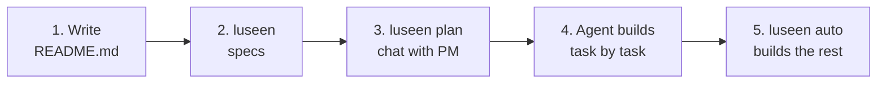

# luseen

Spec-driven development for your project, with Claude.

luseen writes specs for your project, gives your coding agent the skills to work from them, plans roadmaps with a PM agent, and can build whole roadmaps with AI agents.

## Install

You need **Node.js 22.18+** and **Claude Code** logged in.

```bash
npm install -g luseen
claude auth login
luseen doctor          # checks everything is ready
```

No global install? Use `npx luseen` instead of `luseen`.

### Or install the Claude Code plugin

Prefer to stay inside Claude Code? Run these in Claude Code:

```text
/plugin marketplace add Hayko97/cclinic
/plugin install luseen@luseen
/luseen:init
```

The plugin itself holds no MCP server or hook. `/luseen:init` adds luseen's local MCP server to your project's `.mcp.json` and its hook to `.claude/settings.json`, after asking, and writes the specs. Approve the `luseen` server when Claude Code asks (or in `/mcp`).

## Use it: new project, from scratch



> Write the README first. `luseen` needs something to read, and `luseen plan` needs the specs from `luseen`.

### 1. Create the folder and describe the idea

```bash
mkdir clinic-booking && cd clinic-booking
git init
```

Write `README.md` in plain words:

```markdown
# Clinic Booking

A web app where patients book appointments with a clinic's doctors.

## Users

- Patient: finds a doctor, books and cancels.
- Receptionist: sees the day's schedule.

## Features

- Sign up and log in with email.
- Doctor list with free 30-minute slots.
- Book a slot (only once). Cancel up to 2 hours before.

## Stack

React + Vite, Node + Fastify, PostgreSQL.

## Not now

Payments, mobile app.
```

### 2. Generate the specs

```bash
luseen
```

It asks before sending anything to Claude. Say **no** to the local preview for now, since there's no code to run yet. Then answer `.luseen/sdd/open-questions.md`, and commit:

```bash
git add -A && git commit -m "chore: set up luseen"
```

### 3. Plan the roadmap with the PM agent

```bash
luseen plan                               # choose "New roadmap"
luseen plan --attach docs/mockup.png      # or attach mockups and documents
```

Also in `luseen gui` (**New roadmap**), or in Claude Code: "plan a roadmap for the first release" (or `/luseen:plan`).

The PM is a chat. It reads your specs and files, asks a few questions at a time, recommends options, and proposes milestones and tasks. **Nothing is saved until you approve.** An example:

```text
You  > Plan the first release. Start with the foundation: scaffold, lint,
       tests and a runnable app. Then the features, smallest first.

PM   > I read overview.md and the 3 specs. A few questions:
       1. Auth: email + password (recommended), or magic links?
       2. Reminder emails in this release, or later?
       3. Deploy target: none yet (recommended), or a specific host?

You  > Email + password. Reminders later. No deploy yet.

PM   > Proposed roadmap "First release":
       M1 Foundation  T1 Scaffold, lint, tests
                      T2 Database + migrations (needs T1)
                      T3 App shell + health page (needs T1)
       M2 Accounts    T4 Sign up + log in (needs T2, T3)
       M3 Booking     T5 Doctor list + free slots (needs T2)
                      T6 Book a slot (needs T4, T5)
                      T7 Cancel up to 2 hours before (needs T6)
       Approve, or tell me what to change.

You  > Split T6: the double-booking rule as its own task.

PM   > Updated: T6 Book a slot, T7 Block double booking (needs T6),
       T8 Cancel (needs T6). Approve?

You  > approve

luseen > Saved roadmap 1: 3 milestones, 8 tasks.
```

See what was saved:

```bash
luseen tasks roadmap      # roadmaps, milestones and tasks
luseen tasks list         # open tasks, in order
```

Stopped mid-chat? `luseen plan --resume` continues it. Need one more task later? `luseen plan --task --roadmap 1`.

### 4. Build the foundation with your agent

Open Claude Code (or Codex, Cursor, Copilot, Gemini CLI) in the folder:

```text
You    > work on task 1
Agent  > Task 1 uses the "foundation" spec. Spec change:
         FR-…: the project builds, lints and runs its tests with one command.
         approve / refine / review-doc?
You    > approve
Agent  > (writes code and tests, QA tests it, a reviewer checks it)
         All checks pass. Try it: npm run dev → http://localhost:5173
         Approve, or tell me what to change?
You    > approve
Agent  > Task 1 done. Commit it?
You    > yes
```

Repeat for each Foundation task. Once the app runs:

```bash
luseen environment     # every later change ends with a preview link
luseen design          # design system, for projects with screens
```

### 5. Let agents build the rest

```bash
luseen auto --roadmap 1 --dry-run   # checks everything, starts nothing
luseen auto --roadmap 1             # agents build the remaining tasks
```

Agents work on their own branches. Your branch is never touched and nothing is pushed. Read `.luseen/auto/<run-id>/report.md`, then merge `luseen/auto/<run-id>/run` yourself. Watch it live in `luseen gui`.

New idea later? `luseen plan --task`, or ask your agent for it.

More detail, with a full README template and best practices: [NEW_PROJECT_FLOW.md](NEW_PROJECT_FLOW.md).

## Use it: existing project

```bash
cd my-project
luseen --dry-run       # see what will be read and the cost. Sends nothing
luseen                 # writes the specs from your code
git add -A && git commit -m "chore: set up luseen"
```

Then ask your coding agent for any change.

## Use it: Claude Code plugin

After [installing the plugin](#or-install-the-claude-code-plugin), use these in Claude Code:

| Command               | Does                                        |
| --------------------- | ------------------------------------------- |
| `/luseen:init`        | Set up luseen in this project               |
| `/luseen:plan`        | Plan a roadmap or one task with the PM      |
| `/luseen:status`      | Where the current change is, and open tasks |
| `/luseen:gui`         | Open the web board                          |
| `/luseen:create-spec` | Write a spec for a new feature              |
| `/luseen:refine-spec` | Fix or update a spec                        |
| `/luseen:ui-design`   | Create a design system or design a screen   |

Or just ask in plain words: "add password reset", "work on task 3".

## How a change works

Ask your agent (Claude Code, Codex, Cursor, Copilot, Gemini CLI) for a change. It stops for you at each step:

1. **Spec**: it updates the spec. You reply `approve`, `refine` or `review-doc`.
2. **Build**: code and tests. QA and a code review run on their own.
3. **Preview**: you try it, then `approve`.
4. **Commit**: only if you say yes. It never pushes.

## Everyday commands

```bash
luseen gui                         # web board: roadmaps, tasks, agents, questions
luseen plan                        # plan a roadmap
luseen plan --task                 # plan one task
luseen tasks list                  # open tasks
luseen tasks show 5                # one task
luseen auto --roadmap 1 --dry-run  # check an AI run first
luseen auto --roadmap 1            # agents build the roadmap on their own branch
luseen environment                 # set up the local preview
luseen design                      # create a design system
luseen approve                     # answer a question your agent is waiting on
```

`luseen auto` never touches your branch and never pushes. You review `.luseen/auto/<run-id>/report.md` and merge it yourself.

Every command: `luseen help`, or `luseen help <command>`.

## Update

```bash
npm install -g luseen@latest
luseen skills          # update the agent skills in your project
```

## Problems

| Problem                              | Fix                                                       |
| ------------------------------------ | --------------------------------------------------------- |
| `luseen: command not found`          | Use `npx luseen`, or add `$(npm prefix -g)/bin` to `PATH` |
| "No files to analyse remain…"        | The folder is empty: write a README first                 |
| `luseen plan`: `.luseen/sdd` missing | Run `luseen` first                                        |
| Claude not found (exit 3)            | `claude auth login`, then `luseen doctor`                 |
| Usage limit (exit 4)                 | Wait for the reset, run the same command again            |

## Guides

| Guide                                      | About                                     |
| ------------------------------------------ | ----------------------------------------- |
| [NEW_PROJECT_FLOW.md](NEW_PROJECT_FLOW.md) | New project, step by step                 |
| [SETUP_FLOW.md](SETUP_FLOW.md)             | Setup in detail, and how it works inside  |
| [DEVELOPMENT_FLOW.md](DEVELOPMENT_FLOW.md) | How your agent takes a change to a commit |
| [PLANNING_FLOW.md](PLANNING_FLOW.md)       | Planning with the PM                      |
| [AUTO_FLOW.md](AUTO_FLOW.md)               | Running a roadmap with AI                 |
| [GUI_FLOW.md](GUI_FLOW.md)                 | Every screen of the GUI                   |

## Developing luseen

```bash
git clone https://github.com/Hayko97/cclinic.git && cd cclinic
npm install && npm run build && npm link
npm run verify         # lint, types, tests, coverage
```

Specs are in [`.luseen/sdd/`](.luseen/sdd/README.md). After changing skills or the version, run `npm run build:plugin` and commit the result.
