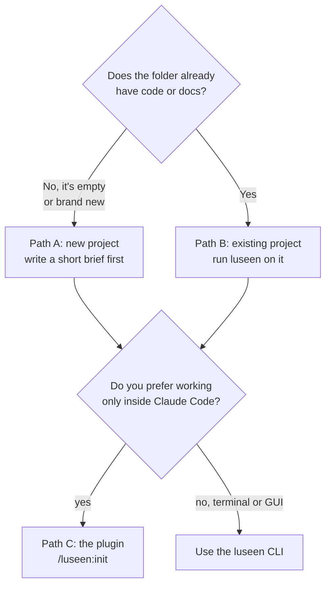
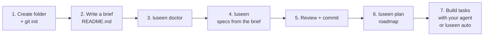
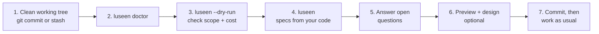
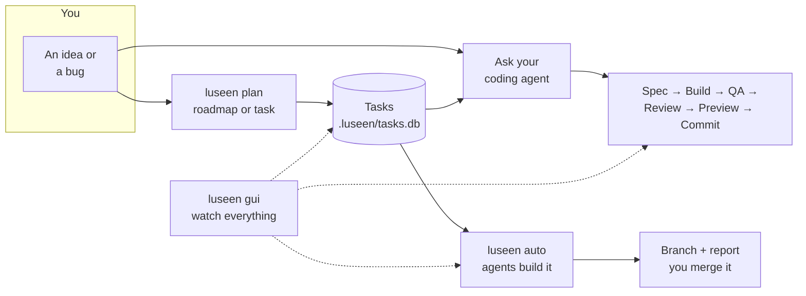
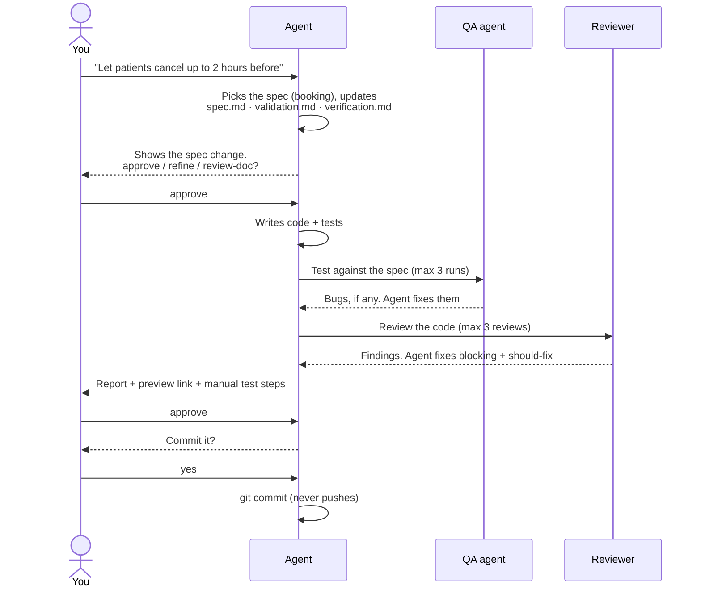
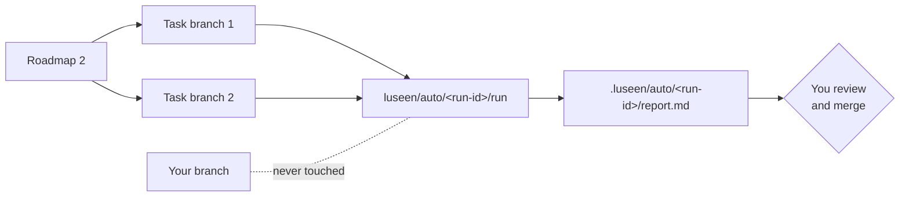
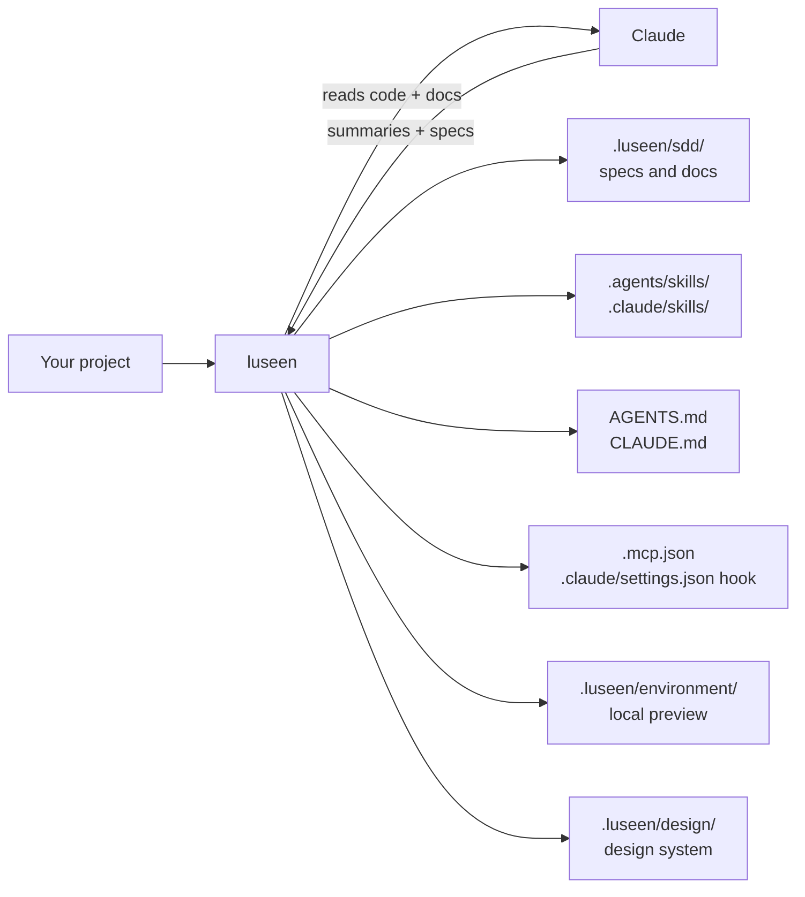
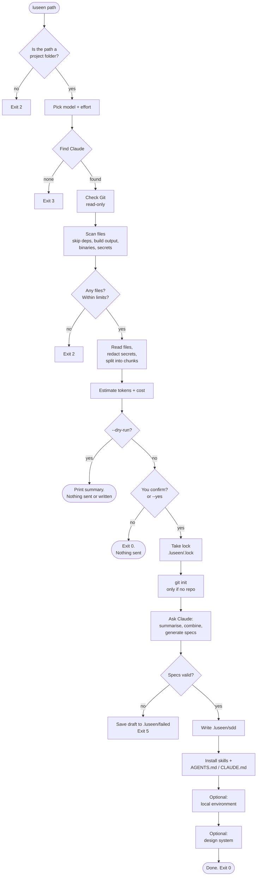
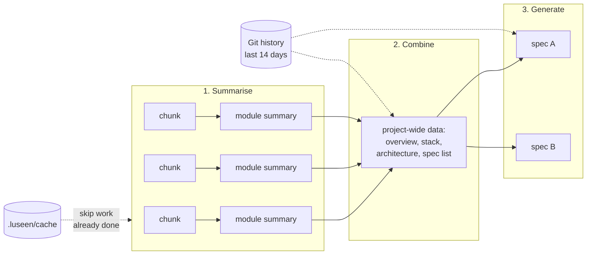
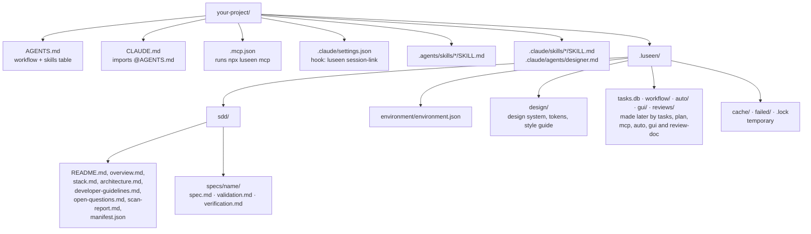

# Setting up and using `luseen`

A step-by-step guide to set up luseen on a **new project** or an **existing project**, and then use it every day. It ends with what luseen does inside, for when you want the details.

Source of truth: the specs in [`.luseen/sdd/specs/`](.luseen/sdd/specs/) and the code in [`src/cli/`](src/cli/). Related guides: [GUI_FLOW.md](GUI_FLOW.md), [DEVELOPMENT_FLOW.md](DEVELOPMENT_FLOW.md), [PLANNING_FLOW.md](PLANNING_FLOW.md) and [AUTO_FLOW.md](AUTO_FLOW.md).

**Contents**

1. [Which path is yours?](#1-which-path-is-yours)
2. [Before you start (both paths)](#2-before-you-start-both-paths)
3. [Path A: a new project](#3-path-a-a-new-project)
4. [Path B: an existing project](#4-path-b-an-existing-project)
5. [Path C: the Claude Code plugin](#5-path-c-the-claude-code-plugin)
6. [Using luseen every day](#6-using-luseen-every-day)
7. [Keeping it up to date](#7-keeping-it-up-to-date)
8. [Troubleshooting](#8-troubleshooting)
9. [How setup works inside](#9-how-setup-works-inside)
10. [Command reference](#10-command-reference)

---

## 1. Which path is yours?



| Your situation                                 | Path | First real command                              |
| ---------------------------------------------- | ---- | ----------------------------------------------- |
| Empty folder, an idea, nothing written yet     | A    | `luseen` or `luseen gui`: the PM interviews you |
| A scaffold (`npm create vite`, `rails new`, …) | A    | write `README.md`, then `luseen`                |
| A working codebase, small or large             | B    | `luseen --dry-run`, then `luseen`               |
| You only use Claude Code and want no CLI       | C    | `/plugin install …`, `/luseen:init`             |

> **An empty folder starts with the PM.** luseen writes specs from what it reads, and an empty folder has nothing to read. So in an empty folder, `luseen` in a terminal, `luseen plan` and the GUI's **Start a new project** start a new-project session instead: the PM interviews you and reads the files you attach, writes the brief as `README.md` once you approve it, and luseen then writes the specs, sets up your coding agents, and has the PM propose the first roadmap. A project with screens also gets a draft design system to approve. In a script (`--yes`, `--json` or no terminal), `luseen` stops with exit code 2 and says so. You can still write the brief yourself first, as below.

---

## 2. Before you start (both paths)

You need **Node.js 22.18 or newer** and **Claude** (a Claude Code login or an API key).

```bash
node --version                  # v22.18.0 or newer
npm install -g luseen           # install luseen
luseen --version

claude auth login               # A (default): your Claude Code login and plan
# or
export ANTHROPIC_API_KEY=<key>  # B: an Anthropic API key
```

Don't want to install it globally? Use `npx luseen` in place of `luseen` in every command below (`npx luseen@latest` for the newest version).

Optional, and it never uses Claude: choose the default model and reasoning level once, for every command.

```bash
luseen model                    # menus
luseen model --model sonnet --effort medium
luseen model --list             # see the current choice
```

---

## 3. Path A: a new project

This is the short version. For the full path, with how to write the brief, how to plan the first roadmap and the best practices, read **[NEW_PROJECT_FLOW.md](NEW_PROJECT_FLOW.md)**.

> You can't start with `luseen plan`: it needs `.luseen/sdd/`, so write the brief and run `luseen` first. Planning needs a Claude Code login (`claude auth login`); an API key alone isn't enough for it.

### A at a glance



### Step A1: create the folder

```bash
mkdir my-app && cd my-app
git init                         # optional: luseen runs git init for you if there's no repo
```

If you use a scaffolder, run it now (for example `npm create vite@latest .`). luseen skips dependencies, build output, lock files and binaries, so the scaffold's own code is what it reads.

### Step A2: write a brief

Write what you want to build in `README.md`, or in `docs/brief.md`. luseen reads Markdown, text, PDF and DOCX, so you can also drop in an existing product brief or requirements document.

A good brief answers six questions. Example:

```markdown
# Clinic Booking

## What it is

A web app where patients book appointments with a clinic's doctors.

## Who uses it

- Patients: find a doctor, see free slots, book and cancel.
- Reception staff: see the day's schedule, add walk-ins.

## Main features

1. Sign up and log in with email.
2. Doctor list with specialities and free slots.
3. Book, reschedule and cancel an appointment.
4. Email reminder 24 hours before.

## Stack

TypeScript, React (Vite), Node + Fastify, PostgreSQL.

## Rules and limits

- A slot can be booked only once.
- Cancel up to 2 hours before.

## Out of scope for now

Payments, video calls, a mobile app.
```

The clearer the brief, the better the first specs. Each feature you list usually becomes one spec folder in `.luseen/sdd/specs/`.

### Step A3: check your setup

```bash
luseen doctor
```

It checks Node.js, Claude, Git and the folder, and never uses Claude. Fix anything marked as a problem before you go on.

### Step A4: generate the specs

```bash
luseen --dry-run    # optional: what would be read, and the estimated cost. Sends nothing
luseen              # shows a summary, then asks before sending anything
```

luseen shows what it will read and the estimated cost, and asks before sending anything. It writes the specs, installs the skills, the `AGENTS.md` and `CLAUDE.md` sections, `.mcp.json` and the session hook, then offers a local preview and a design system.

With only a brief, every requirement is `docs-only` and `stack.md` says no code was found. For a project with no runnable code yet, answer **no** to the local preview, and run `luseen environment` once the app starts. The design system step may find no screens to design for yet and write nothing; agents then create it at the first change that touches UI.

### Step A5: review and commit

Open [`.luseen/sdd/README.md`](.luseen/sdd/README.md) in your project. It lists every spec. Read `overview.md` and a spec or two, and fix anything wrong by hand, or ask your agent to "refine the booking spec".

```bash
git add .luseen/sdd .agents .claude AGENTS.md CLAUDE.md .mcp.json
git commit -m "chore: set up luseen specs and agent skills"
```

### Step A6: plan the roadmap

```bash
luseen plan
```

The PM agent reads your specs, asks a few questions at a time, recommends options and proposes milestones and tasks with their dependencies. Nothing is saved until you approve. Attach mockups or briefs with `--attach design.png`.

```bash
luseen tasks roadmap            # see what was saved
```

### Step A7: build it

Either work task by task with your coding agent ([section 6.2](#62-make-a-change-with-your-coding-agent)), or let agents build a whole roadmap on their own branches ([section 6.5](#65-run-a-roadmap-with-ai)).

---

## 4. Path B: an existing project

### B at a glance



### Step B1: start from a clean tree

```bash
cd /path/to/your-project
git status                      # commit or stash your own changes first
```

luseen never commits, stages or pushes, but a clean tree makes its new files easy to review.

### Step B2: check your setup

```bash
luseen doctor
```

### Step B3: check what will be read, and the cost

```bash
luseen --dry-run                # summary only. Sends and writes nothing
luseen --dry-run --json         # every file, and why each skipped one was skipped
```

luseen already skips `node_modules`, build output, vendored code, binaries, `.env` files, keys and credentials. Narrow it further when the project is big or has folders that don't matter:

```bash
luseen --dry-run --exclude "legacy/**" --exclude "**/*.generated.ts"
luseen --dry-run --include "docs/architecture.pdf"
```

Big runs stop before sending anything. Raise a limit only if you mean to:

```bash
luseen --max-files 5000 --max-input-tokens 3000000
luseen --max-budget-usd 10      # aim to stop once this estimated spend is reached
```

### Step B4: generate the specs

```bash
luseen
```

luseen summarises your code module by module, combines the summaries into a project picture, and writes one spec per area of the code, each with requirements (`FR-`), acceptance checks (`VAL-`) and test cases (`TC-`). It also sends Claude recent commit messages and file names (the last 14 days, never diffs or authors) for context. Turn this off with `--no-git`.

If it stops halfway, such as at a usage limit, run the same command again: finished work is cached, and it carries on where it stopped.

### Step B5: review the result

```text
.luseen/sdd/
├── README.md                ← start here: the list of specs
├── overview.md              ← what the project is
├── stack.md                 ← languages, frameworks, tools
├── architecture.md          ← how the parts fit
├── developer-guidelines.md  ← the coding rules agents follow
├── open-questions.md        ← what luseen couldn't tell from the code
├── scan-report.md           ← what was read and skipped
└── specs/<area>/
    ├── spec.md              ← requirements FR-*
    ├── validation.md        ← acceptance checks VAL-*
    └── verification.md      ← test cases TC-*
```

Go through `open-questions.md` first. Answer them in place, or ask your agent: "refine the specs using my answers in open-questions.md". Check that `developer-guidelines.md` matches how your team really writes code, since every agent follows it.

### Step B6: set up the preview and design system (optional)

```bash
luseen environment              # how to run the app locally, for previews after each change
luseen design                   # a design system for the UI, in .luseen/design/
```

`luseen environment` writes `.luseen/environment/environment.json` with your project's start commands, so agents can show you each change running before you approve it.

### Step B7: commit

```bash
git add .luseen/sdd .luseen/environment .luseen/design .agents .claude AGENTS.md CLAUDE.md .mcp.json
git commit -m "chore: set up luseen specs and agent skills"
```

Your existing `AGENTS.md` and `CLAUDE.md` are kept: luseen only adds its own section between markers, and leaves the rest of the file alone.

---

## 5. Path C: the Claude Code plugin

If you work only inside Claude Code, install the plugin instead of the skill folders. Works for a new or an existing project (a new project still needs its brief, as in [step A2](#step-a2-write-a-brief)).

```text
/plugin marketplace add Hayko97/cclinic
/plugin install luseen@luseen
/luseen:init
```

On Claude Code 2.1.275 or later, `/plugin install luseen --marketplace Hayko97/cclinic` does the first two in one step.

`/luseen:init` asks before it adds luseen's MCP server to `.mcp.json` and the session hook to `.claude/settings.json`, then generates the specs and the `AGENTS.md` and `CLAUDE.md` sections. Approve the project's `luseen` server when Claude Code asks, or in `/mcp`. The skills come from the plugin as `/luseen:create-spec`, `/luseen:plan`, `/luseen:status`, `/luseen:gui` and more, so your project gets no skill folders.

From a terminal, the same setup is:

```bash
luseen --plugin
```

---

## 6. Using luseen every day



### 6.1 Open the GUI

```bash
luseen gui                      # opens http://127.0.0.1:4417/... in your browser
luseen gui --port 5000 --no-open
```

Keep the terminal open, and press Ctrl+C to stop. In the GUI you can do the setup, see the roadmap canvas, plan, run roadmaps with AI, and answer agents' questions. Every screen is in [GUI_FLOW.md](GUI_FLOW.md).

### 6.2 Make a change with your coding agent

Open your agent (Claude Code, Codex, Cursor, Copilot or Gemini CLI) in the project, and ask for the change in plain words. The agent follows the steps in `AGENTS.md`, and waits for you at each gate:



Example prompts:

| You say                                             | What happens                                         |
| --------------------------------------------------- | ---------------------------------------------------- |
| "Add a reminder email 24 hours before a booking"    | New requirement in the matching spec, then the build |
| "Booking the same slot twice doesn't show an error" | Bug: a test case that reproduces it, then the fix    |
| "Rename `utils.ts` to `dates.ts`"                   | No behaviour change: no spec step, straight to build |
| "What does the booking spec cover?"                 | Just an answer. Nothing changes                      |
| "Redesign the doctor list page"                     | The `ui-design` skill, following the design system   |

At the spec gate, reply with one word:

- **`approve`**: build it.
- **`refine`** (with what to change): the agent edits the spec and asks again.
- **`review-doc`**: the agent writes a visual doc in `.luseen/reviews/<spec>/review.md` of how it will work and look, for you to read first.

Your agent is waiting on a question and you'd rather answer elsewhere? Use `luseen approve` in a terminal, or the GUI's task panel. Full details: [DEVELOPMENT_FLOW.md](DEVELOPMENT_FLOW.md).

### 6.3 Plan work with the PM

```bash
luseen plan                         # a new roadmap
luseen plan --roadmap 1             # extend roadmap 1
luseen plan --task                  # one concrete task
luseen plan --task --roadmap 1      # one task, added to roadmap 1
luseen plan --attach brief.pdf      # attach a brief, image or document
luseen plan --resume                # list sessions to continue
```

Example session, abbreviated:

```text
You  > We need online payments for bookings.
PM   > I read the booking and auth specs. Three questions:
       1. Which provider: Stripe (recommended), or one you already use?
       2. Pay when booking, or after the visit?
       3. Refunds on cancel: full, partial, or none?
You  > Stripe, when booking, full refund up to 2 hours before.
PM   > Proposed roadmap "Payments":
       M1 Checkout      T1 Stripe setup · T2 Pay when booking (needs T1)
       M2 Refunds       T3 Full refund on cancel (needs T2)
       Approve, or tell me what to change.
You  > approve
PM   > Saved roadmap 2 with 2 milestones and 3 tasks.
```

More in [PLANNING_FLOW.md](PLANNING_FLOW.md).

### 6.4 Track tasks

```bash
luseen tasks list                   # open, in-progress and blocked tasks, in roadmap order
luseen tasks roadmaps               # every roadmap with counts
luseen tasks roadmap show 2         # one roadmap's milestones and tasks
luseen tasks show 5                 # every detail of task 5
luseen tasks start 5                # mark as in progress
luseen tasks done 5                 # mark as done
luseen tasks add --title "Fix slot timezone bug" --spec booking --description "src/slots.ts:42 uses local time"
luseen tasks depend 6 --on 5        # task 6 now depends on task 5
luseen tasks remove 7               # delete a task
```

To work on a task with your agent, say "work on task 5". The agent marks it started, uses its spec, and marks it done once you approve. Agents also save problems they notice but don't fix as tasks with no milestone, so nothing is lost.

### 6.5 Run a roadmap with AI

```bash
luseen auto --roadmap 2 --dry-run   # check everything and see the plan, without starting
luseen auto --roadmap 2             # run it
luseen auto --roadmap 2 --developers 3
```



Developer, PM and QA agents build each task on its own branch, and merge it into the run branch. Your branch is never touched, and nothing is pushed. If your Claude plan limit is reached, the run stops cleanly; continue it later from the GUI. More in [AUTO_FLOW.md](AUTO_FLOW.md).

---

## 7. Keeping it up to date

| When                                  | Run                                                  | What it does                                                     |
| ------------------------------------- | ---------------------------------------------------- | ---------------------------------------------------------------- |
| The code changed a lot outside luseen | `luseen`                                             | Reprocesses only what changed. Stops if docs were edited by hand |
| You want to regenerate everything     | `luseen --force`                                     | Replaces hand-edited docs too. Commit first                      |
| A new luseen version is out           | `npm install -g luseen@latest`, then `luseen skills` | Updates the skills and `AGENTS.md` section. No Claude usage      |
| You edited a skill and want it back   | `luseen skills --force`                              | Replaces luseen skills that were edited                          |
| How to run the app changed            | `luseen environment --force`                         | Sets up the preview again                                        |
| You want a new design direction       | `luseen design --force`                              | Creates the design system again                                  |
| Disk space, or after a failed run     | `luseen clean`                                       | Deletes `cache/` and `failed/` only                              |

---

## 8. Troubleshooting

| Problem                                          | Fix                                                                                                                                                                              |
| ------------------------------------------------ | -------------------------------------------------------------------------------------------------------------------------------------------------------------------------------- |
| `luseen: command not found`                      | Add npm's global `bin` folder to your `PATH` (see `npm prefix -g`), or use `npx luseen`                                                                                          |
| `EACCES: permission denied` on install           | Don't use `sudo`. Install Node.js with a version manager such as nvm                                                                                                             |
| "Nothing to analyse in …" (exit 2)               | The folder is empty and `luseen` ran in a script. Run `luseen` in a terminal or `luseen gui` to start a new project with the PM, or write a brief ([A2](#step-a2-write-a-brief)) |
| "No files to analyse remain…" (exit 2)           | Everything was excluded in a project that's set up. Check `luseen --dry-run --json`                                                                                              |
| "`.luseen/sdd` doesn't exist" from `luseen plan` | Run `luseen` in the project first                                                                                                                                                |
| Exit 3, no Claude provider                       | `claude auth login`, or set `ANTHROPIC_API_KEY`. Then `luseen doctor`                                                                                                            |
| Exit 4, usage limit or budget hit                | Wait for the limit to reset, or raise `--max-budget-usd`, then run the same command again                                                                                        |
| Exit 5, specs failed validation                  | The draft is saved in `.luseen/failed/`. Run again; add `--debug-file debug.log` to see why                                                                                      |
| Too many files or tokens (exit 2)                | Use `--exclude`, or raise `--max-files` / `--max-input-tokens` on purpose                                                                                                        |
| It refuses your home folder or `/`               | `cd` into the project folder. Use `--allow-broad-target` only if you mean it                                                                                                     |
| No terminal (CI) and no `--yes` (exit 2)         | Add `--yes` to confirm without a prompt                                                                                                                                          |
| The agent doesn't follow the steps               | Check `AGENTS.md` has the luseen section and `CLAUDE.md` imports it; run `luseen skills`                                                                                         |
| Anything else                                    | `luseen doctor`, or `luseen guide` for the offline walkthrough                                                                                                                   |

---

## 9. How setup works inside

### 9.1 The big picture

You point `luseen` at a project. It reads the code and documents, asks Claude to describe the project, and writes specs and agent instructions back into the project.



### 9.2 The setup flow, step by step



| Step        | What happens                                                                                              | Spec                                                                                                                       |
| ----------- | --------------------------------------------------------------------------------------------------------- | -------------------------------------------------------------------------------------------------------------------------- |
| Check path  | Must be a folder. Home folder or `/` is refused unless `--allow-broad-target`.                            | [cli-commands](.luseen/sdd/specs/cli-commands/spec.md)                                                                     |
| Pick model  | Option → env var → saved default → built-in (Sonnet, medium).                                             | [model-selection](.luseen/sdd/specs/model-selection/spec.md)                                                               |
| Find Claude | Claude CLI if logged in, else `ANTHROPIC_API_KEY`, else exit 3.                                           | [llm-providers](.luseen/sdd/specs/llm-providers/spec.md)                                                                   |
| Check Git   | Only looks. Never commits, stages or pushes.                                                              | [git-setup](.luseen/sdd/specs/git-setup/spec.md)                                                                           |
| Scan        | Finds the project's own files. Every skipped file gets a reason.                                          | [file-discovery](.luseen/sdd/specs/file-discovery/spec.md)                                                                 |
| Read        | Text from code, PDF, DOCX with line/page positions.                                                       | [content-extraction](.luseen/sdd/specs/content-extraction/spec.md)                                                         |
| Confirm     | Shows a summary, then asks. No terminal and no `--yes` → exit 2.                                          | [cli-commands](.luseen/sdd/specs/cli-commands/spec.md)                                                                     |
| Ask Claude  | The 3 LLM stages, below.                                                                                  | [spec-analysis](.luseen/sdd/specs/spec-analysis/spec.md)                                                                   |
| Write       | Validate first, then write all at once.                                                                   | [spec-output](.luseen/sdd/specs/spec-output/spec.md)                                                                       |
| Skills      | Ten skills, the `designer` agent, workflow sections, the `luseen mcp` entry and the session hook. No LLM. | [agent-skills](.luseen/sdd/specs/agent-skills/spec.md), [agent-instructions](.luseen/sdd/specs/agent-instructions/spec.md) |
| Environment | Claude sets up `environment.json` with the `local-env` skill, only if you agree.                          | [local-environment](.luseen/sdd/specs/local-environment/spec.md)                                                           |
| Design      | Claude writes a design system to `.luseen/design/`, only if you agree.                                    | [ui-design](.luseen/sdd/specs/ui-design/spec.md)                                                                           |

### 9.3 What Claude does (the 3 LLM stages)



- **Summarise** runs in parallel (`--concurrency`, default 4). Each chunk is at most 150,000 tokens.
- **Combine** merges in stages if the summaries are too big for one request.
- **Generate** writes requirements (`FR-`), acceptance checks (`VAL-`) and test cases (`TC-`) for each spec.
- Results are cached, so re-running the same command continues where it stopped.

### 9.4 What ends up in your project



| Commit it                                                                              | Don't need to commit                                 |
| -------------------------------------------------------------------------------------- | ---------------------------------------------------- |
| `.luseen/sdd/`, `.luseen/environment/`, `.luseen/design/`                              | `.luseen/cache/`, `.luseen/failed/`, `.luseen/.lock` |
| `.agents/`, `.claude/skills/`, `.claude/agents/`, `.claude/settings.json`, `.mcp.json` | `.luseen/reviews/` (unless you want to share them)   |
| `AGENTS.md`, `CLAUDE.md`                                                               |                                                      |

`luseen clean` deletes only `cache/` and `failed/`. It never touches `sdd/`, `tasks.db`, `workflow/`, `auto/` or `gui/`.

---

## 10. Command reference

| Command              | Does                                                                | Uses Claude |
| -------------------- | ------------------------------------------------------------------- | ----------- |
| `luseen`             | Generate docs and specs, and install skills                         | yes         |
| `luseen --dry-run`   | Show what would be scanned and the cost. Sends and writes nothing   | no          |
| `luseen doctor`      | Check that everything is ready                                      | no          |
| `luseen skills`      | Install only the skills and `AGENTS.md`/`CLAUDE.md` sections        | no          |
| `luseen environment` | Set up the local preview                                            | yes         |
| `luseen design`      | Create a design system for the UI                                   | yes         |
| `luseen model`       | List, choose or reset the saved default model                       | no          |
| `luseen plan`        | Plan a roadmap or one task with the PM agent. Saves only on approve | yes         |
| `luseen tasks`       | See roadmaps and track tasks                                        | no          |
| `luseen auto`        | Run a whole roadmap with agents, on its own branches                | yes         |
| `luseen approve`     | Answer a question your agent is waiting on, in your terminal        | no          |
| `luseen mcp`         | The MCP server your coding agent starts, to enforce the stages      | depends     |
| `luseen gui`         | Open the local web GUI for this project                             | no\*        |
| `luseen clean`       | Delete the cache and failed drafts                                  | no          |
| `luseen guide`       | Offline walkthrough in the terminal                                 | no          |

\* Only the actions you start in it, such as Plan or Run with AI. Run `luseen help <command>` for a command's options.

### Exit codes

| Code      | Meaning                                                             |
| --------- | ------------------------------------------------------------------- |
| 0         | Success, or you declined                                            |
| 1         | Internal error                                                      |
| 2         | Usage error (bad path, no files, limits, no terminal)               |
| 3         | No Claude provider                                                  |
| 4         | LLM failure, generate's budget hit, or Claude's usage limit reached |
| 5         | Generated specs failed validation                                   |
| 130 / 143 | Stopped with Ctrl+C / SIGTERM                                       |

`luseen auto` has its own exit codes for its outcomes: see [AUTO_FLOW.md](AUTO_FLOW.md).
