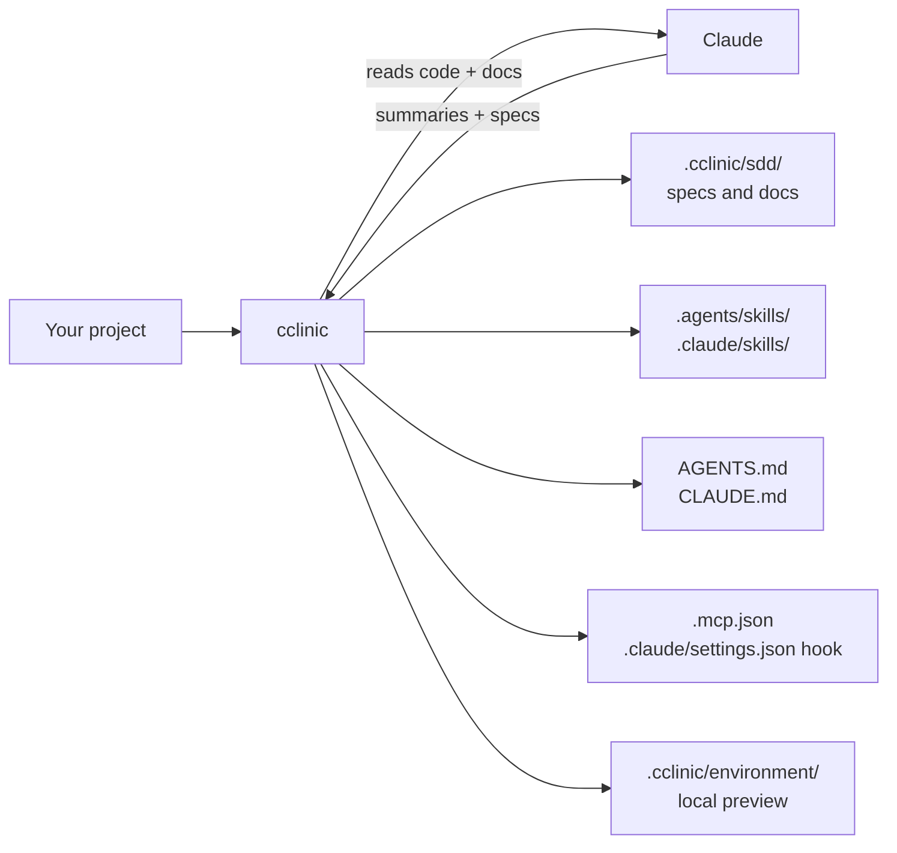
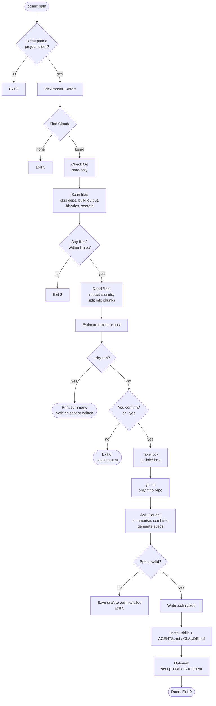
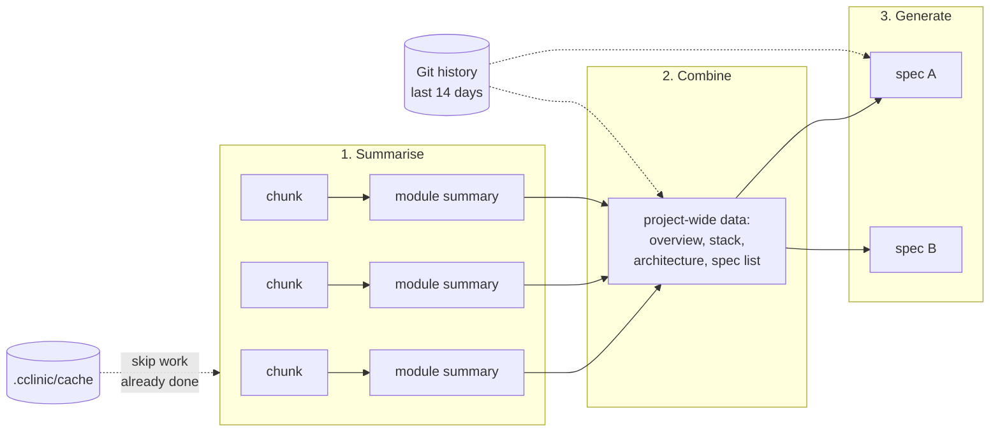
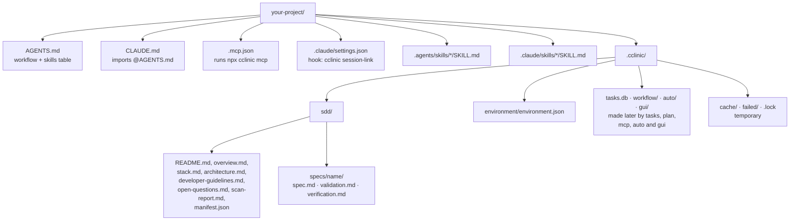
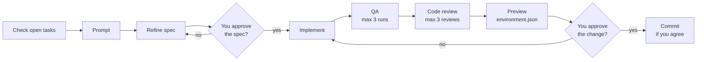

# How `cclinic` setup works

A simple picture of what happens when you run `cclinic` on a project.

Source of truth: the specs in [`.cclinic/sdd/specs/`](.cclinic/sdd/specs/) and the code in [`src/cli/generate-command.ts`](src/cli/generate-command.ts). You can also do the whole setup from the GUI's Setup screen: see [GUI_FLOW.md](GUI_FLOW.md). What comes after setup is in [DEVELOPMENT_FLOW.md](DEVELOPMENT_FLOW.md), [PLANNING_FLOW.md](PLANNING_FLOW.md) and [AUTO_FLOW.md](AUTO_FLOW.md).

---

## 1. The big picture

You point `cclinic` at a project. It reads the code and documents, asks Claude to describe the project, and writes specs and agent instructions back into the project.

---

## 2. The setup flow, step by step

| Step        | What happens                                                                          | Spec                                                                                                                         |
| ----------- | ------------------------------------------------------------------------------------- | ---------------------------------------------------------------------------------------------------------------------------- |
| Check path  | Must be a folder. Home folder or `/` is refused unless `--allow-broad-target`.        | [cli-commands](.cclinic/sdd/specs/cli-commands/spec.md)                                                                      |
| Pick model  | Option → env var → saved default → built-in (Sonnet, medium).                         | [model-selection](.cclinic/sdd/specs/model-selection/spec.md)                                                                |
| Find Claude | Claude CLI if logged in, else `ANTHROPIC_API_KEY`, else exit 3.                       | [llm-providers](.cclinic/sdd/specs/llm-providers/spec.md)                                                                    |
| Check Git   | Only looks. Never commits, stages or pushes.                                          | [git-setup](.cclinic/sdd/specs/git-setup/spec.md)                                                                            |
| Scan        | Finds the project's own files. Every skipped file gets a reason.                      | [file-discovery](.cclinic/sdd/specs/file-discovery/spec.md)                                                                  |
| Read        | Text from code, PDF, DOCX with line/page positions.                                   | [content-extraction](.cclinic/sdd/specs/content-extraction/spec.md)                                                          |
| Confirm     | Shows a summary, then asks. No terminal and no `--yes` → exit 2.                      | [cli-commands](.cclinic/sdd/specs/cli-commands/spec.md)                                                                      |
| Ask Claude  | The 3 LLM stages, below.                                                              | [spec-analysis](.cclinic/sdd/specs/spec-analysis/spec.md)                                                                    |
| Write       | Validate first, then write all at once.                                               | [spec-output](.cclinic/sdd/specs/spec-output/spec.md)                                                                        |
| Skills      | Nine skills, workflow sections, the `cclinic mcp` entry and the session hook. No LLM. | [agent-skills](.cclinic/sdd/specs/agent-skills/spec.md), [agent-instructions](.cclinic/sdd/specs/agent-instructions/spec.md) |
| Environment | Claude sets up `environment.json` with the `local-env` skill, only if you agree.      | [local-environment](.cclinic/sdd/specs/local-environment/spec.md)                                                            |

---

## 3. What Claude does (the 3 LLM stages)

- **Summarise** runs in parallel (`--concurrency`, default 4). Each chunk is at most 150,000 tokens.
- **Combine** merges in stages if the summaries are too big for one request.
- **Generate** writes requirements (`FR-`), acceptance checks (`VAL-`) and test cases (`TC-`) for each spec.
- Results are cached, so re-running the same command continues where it stopped.

---

## 4. What ends up in your project

`cclinic clean` deletes only `cache/` and `failed/`. It never touches `sdd/`, `tasks.db`, `workflow/`, `auto/` or `gui/`.

---

## 5. After setup: how an agent works

`AGENTS.md` tells coding agents to follow this loop for every change, and `cclinic mcp` can enforce it as gates. The full flow is in [DEVELOPMENT_FLOW.md](DEVELOPMENT_FLOW.md).

---

## 6. Other commands

| Command               | Does                                                                 |
| --------------------- | -------------------------------------------------------------------- |
| `cclinic --dry-run`   | Shows what would be scanned and the cost. Sends and writes nothing.  |
| `cclinic skills`      | Installs only the skills and `AGENTS.md`/`CLAUDE.md`. No LLM.        |
| `cclinic environment` | Sets up only the local environment.                                  |
| `cclinic model`       | Lists, chooses or resets the saved default model.                    |
| `cclinic doctor`      | Checks that everything is ready. Never calls a model.                |
| `cclinic clean`       | Deletes the cache and failed drafts.                                 |
| `cclinic guide`       | Offline walkthrough.                                                 |
| `cclinic tasks`       | See roadmaps and track tasks. No LLM.                                |
| `cclinic plan`        | Plan a roadmap or one task with the PM agent. Saves only on approve. |
| `cclinic auto`        | Run a whole roadmap with agents, on its own branches.                |
| `cclinic mcp`         | The MCP server your coding agent starts, to enforce the stages.      |
| `cclinic approve`     | Answer a question the MCP server is waiting on, in your terminal.    |
| `cclinic gui`         | Open the local web GUI for this project.                             |

## 7. Exit codes

| Code      | Meaning                                                             |
| --------- | ------------------------------------------------------------------- |
| 0         | Success, or you declined                                            |
| 1         | Internal error                                                      |
| 2         | Usage error (bad path, limits, no terminal)                         |
| 3         | No Claude provider                                                  |
| 4         | LLM failure, generate's budget hit, or Claude's usage limit reached |
| 5         | Generated specs failed validation                                   |
| 130 / 143 | Stopped with Ctrl+C / SIGTERM                                       |

`cclinic auto` has its own exit codes for its outcomes: see [AUTO_FLOW.md](AUTO_FLOW.md).
